# EEE103 期中模拟卷（二）· 选择题（中文版）

> **范围**：Week 1 – Week 7（Part 1 + Part 2）
> **题量**：20 道选择题 ｜ **建议时间**：40 分钟 ｜ 每题 5 分
> **难度**：对标 Weekly Tutorial
> **说明**：先独立完成（在纸上写题号和选项即可），完成后把答案上传给我，我会批改并针对错题出复盘练习。
> ⚠️ 本卷暂不提供答案。

---

1. 某元件的电压为 $v=10\,\mathrm{V}$（上端为正），电流 $3\,\mathrm{A}$ 从下端流入、上端流出（即从「+」端流出）。按被动符号约定，该元件**吸收**的功率为：

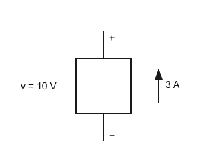

A. 30 W　B. −30 W　C. 3.33 W　D. 0 W

2. 恒定电流 $i=4\,\mathrm{A}$ 流过某截面，5 s 内通过该截面的电量为：
A. 0.8 C　B. 4 C　C. 5 C　D. 20 C

3. 某电压控制电压源（VCVS）的输出电压为 $5v_x$，已知 $v_x=3\,\mathrm{V}$，则该受控源电压为：
A. 3 V　B. 5 V　C. 8 V　D. 15 V

4. $6\,\Omega$ 电阻与 $(3\,\Omega \parallel 6\,\Omega)$ 串联，总等效电阻为：

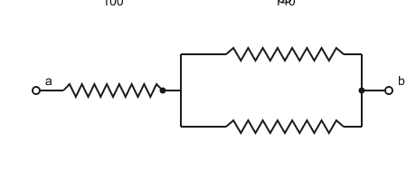

A. 2 Ω　B. 7.5 Ω　C. 8 Ω　D. 15 Ω

5. 12 V 电压加在 $4\,\Omega$ 与 $8\,\Omega$ 的串联电阻上，$8\,\Omega$ 两端的电压为：

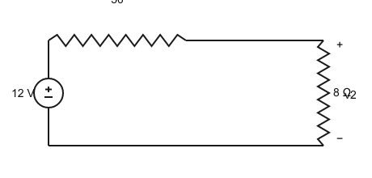

A. 8 V　B. 4 V　C. 6 V　D. 9.6 V

6. 3 A 电流分流到 $6\,\Omega$ 与 $3\,\Omega$ 的并联支路，流过 $3\,\Omega$ 的电流为：

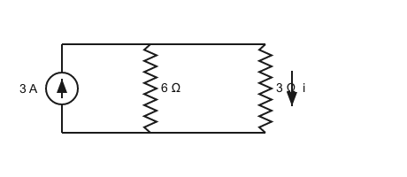

A. 0.5 A　B. 1 A　C. 1.5 A　D. 2 A

7. 节点分析：参考节点为 0；6 A 源流入节点 1，2 A 源流入节点 2；4 Ω 接于 1–0、2 Ω 接于 1–2、6 Ω 接于 2–0（见图）。节点电压 $v_1$ 为：

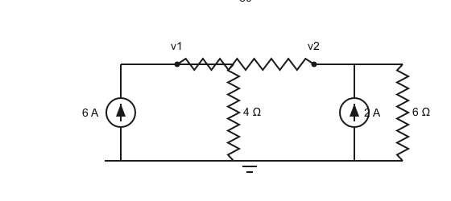

A. 18 V　B. 24 V　C. 12 V　D. 20 V

8. 网孔分析中，两相邻网孔的电流均为顺时针方向 $i_1$、$i_2$，其公共支路的电流等于：

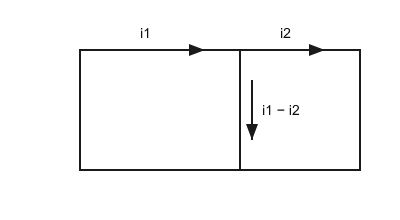

A. $i_1+i_2$　B. $i_1-i_2$　C. $i_2-i_1$　D. $i_1\,i_2$

9. 节点分析（见图）：2 Ω 接于节点 1–0、5 Ω 接于节点 1–2、1 Ω 接于节点 2–0；3.1 A 流入节点 1，1.4 A 流入节点 2。则 $v_1$ 为：

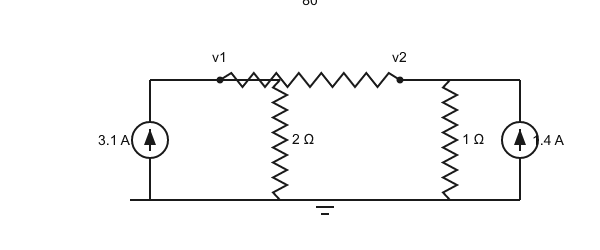

A. 5 V　B. 2 V　C. 3.1 V　D. 10 V

10. 叠加定理（见图）：3 V 电压源（正极在上）与 6 Ω、9 Ω 串联构成回路；2 A 电流源（箭头向上）并联在 9 Ω 两端；$i_x$ 为流过 9 Ω 的电流（向下为正）。用叠加定理求 $i_x$：

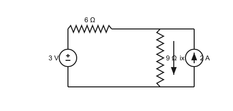

A. 0.2 A　B. 1.0 A　C. 1.2 A　D. 0.8 A

11. 戴维南（见图）：12 V 源（正极在上）串 3 Ω，随后一路经 6 Ω 接回电源负极（参考地 b），另一路经 7 Ω 接端子 a（a-b 开路）。$V_{TH}$ 为：

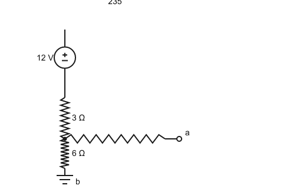

A. 6 V　B. 4 V　C. 8 V　D. 12 V

12. 接上题（$V_{TH}=8\,\mathrm{V}$，$R_{TH}=9\,\Omega$），负载 $R_L$ 可获得的最大功率为：

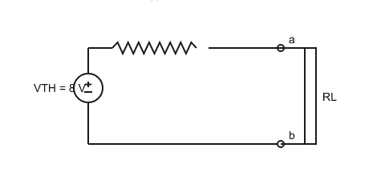

A. 0.89 W　B. 0.44 W　C. 3.56 W　D. 1.78 W

13. 反相放大器：$R_1=10\,\mathrm{k\Omega}$，$R_f=50\,\mathrm{k\Omega}$，$v_{in}=0.4\,\mathrm{V}$（见图）。输出 $v_{out}$ 为：

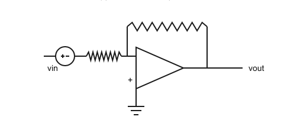

A. −5 V　B. +2 V　C. −2 V　D. −20 V

14. 施密特触发器（见图）：$R_1=10\,\mathrm{k\Omega}$ 接于输出与同相输入端之间，$R_2=30\,\mathrm{k\Omega}$ 接于同相输入端与地之间，饱和电平 $\pm12\,\mathrm{V}$。上阈值（upper threshold）为：

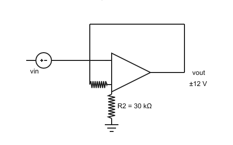

A. +3 V　B. +9 V　C. +12 V　D. +0.25 V

15. 加法器（见图）：$R=20\,\mathrm{k\Omega}$，$R_f=40\,\mathrm{k\Omega}$，输入 $v_1=1\,\mathrm{V}$、$v_2=0.5\,\mathrm{V}$。输出为：

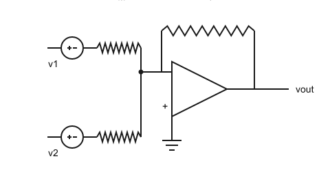

A. +3 V　B. +1.5 V　C. −1.5 V　D. −3 V

16. $2\,\mu\mathrm{F}$ 电容两端 $v(t)=10e^{-1000t}\,\mathrm{V}$（$t\ge0$），$t=0$ 时的储能为：
A. 200 µJ　B. 100 µJ　C. 50 µJ　D. 1 mJ

17. $2\,\mathrm{H}$ 与 $3\,\mathrm{H}$ 电感并联的等效电感为：
A. 1.2 H　B. 0.833 H　C. 5 H　D. 6 H

18. $R=2\,\mathrm{k\Omega}$ 与 $C=10\,\mu\mathrm{F}$ 构成 RC 电路（见图），其时间常数 $\tau$ 为：

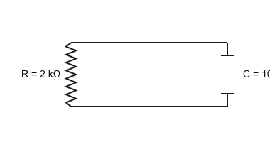

A. 5 ms　B. 20 ms　C. 200 ms　D. 50 ms

19. 无源 RC 放电（见图）：$v_C(0)=6\,\mathrm{V}$，$\tau=20\,\mathrm{ms}$。$v_C$ 首次降到 $2\,\mathrm{V}$ 的时刻约为：

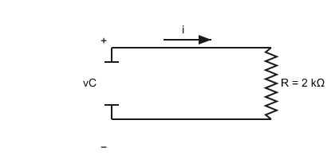

A. 40 ms　B. 10 ms　C. 22 ms　D. 20 ms

20. $20u(t)\,\mathrm{V}$ 电压源与 $200\,\Omega$、$4\,\mathrm{H}$ 串联（见图），$t=8\,\mathrm{ms}$ 时电感电流约为：

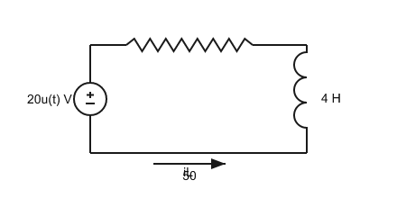

A. 63 mA　B. 100 mA　C. 33 mA　D. 10 mA

---

## 答题提示

- 每题约 2 分钟；计算题先写公式再代数值。
- 注意功率符号、分流公式分子、$\tau=R_{eq}C$ 中 $R_{eq}$ 的取法。
- 完成后上传答案（写题号 + 选项，如 `1B 2D 3D …`），我会逐题批改。
