# EEE103 Midterm Mock (II) · Multiple Choice (English)

> **Scope**: Week 1 – Week 7 (Part 1 + Part 2)
> **Format**: 20 multiple-choice questions ｜ **Suggested time**: 40 minutes ｜ 5 marks each
> **Difficulty**: matched to the weekly tutorials
> **Note**: Complete it on your own first (write down question numbers and options), then upload your answers; I will mark them and create review exercises based on your mistakes.
> ⚠️ Answers are not provided in this paper yet.

---

1. An element has $v=10\,\mathrm{V}$ (+ on top) and a current of $3\,\mathrm{A}$ entering the bottom terminal and leaving the top terminal (i.e. leaving the "+" terminal). Under the passive sign convention, the power **absorbed** by the element is:

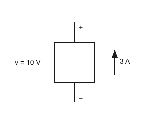

A. 30 W　B. −30 W　C. 3.33 W　D. 0 W

2. A constant current $i=4\,\mathrm{A}$ flows through a cross-section. The charge passing through the cross-section in 5 s is:
A. 0.8 C　B. 4 C　C. 5 C　D. 20 C

3. A voltage-controlled voltage source (VCVS) has an output voltage of $5v_x$. If $v_x=3\,\mathrm{V}$, the source voltage is:
A. 3 V　B. 5 V　C. 8 V　D. 15 V

4. A $6\,\Omega$ resistor in series with $(3\,\Omega \parallel 6\,\Omega)$ has a total equivalent resistance of:

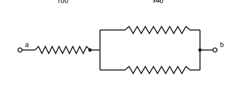

A. 2 Ω　B. 7.5 Ω　C. 8 Ω　D. 15 Ω

5. A 12 V source is applied across a series combination of $4\,\Omega$ and $8\,\Omega$. The voltage across the $8\,\Omega$ resistor is:

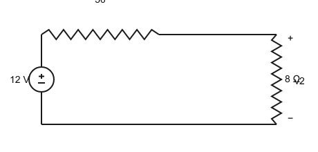

A. 8 V　B. 4 V　C. 6 V　D. 9.6 V

6. A 3 A current divides between a $6\,\Omega$ and a $3\,\Omega$ branch in parallel. The current through the $3\,\Omega$ resistor is:

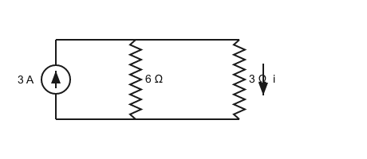

A. 0.5 A　B. 1 A　C. 1.5 A　D. 2 A

7. Nodal analysis (see figure): with reference node 0, a 6 A source into node 1 and a 2 A source into node 2; a 4 Ω resistor from node 1 to 0, a 2 Ω resistor from node 1 to 2, and a 6 Ω resistor from node 2 to 0. The node voltage $v_1$ is:

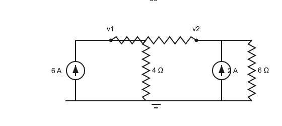

A. 18 V　B. 24 V　C. 12 V　D. 20 V

8. In mesh analysis, if two adjacent meshes both carry clockwise currents $i_1$ and $i_2$, the current in their shared branch equals:

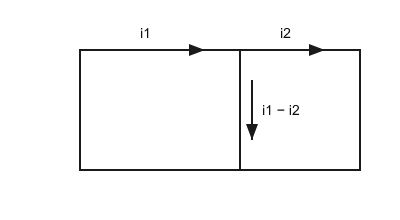

A. $i_1+i_2$　B. $i_1-i_2$　C. $i_2-i_1$　D. $i_1\,i_2$

9. Nodal analysis (see figure): a 2 Ω resistor from node 1 to 0, a 5 Ω resistor from node 1 to 2, a 1 Ω resistor from node 2 to 0; 3.1 A flows into node 1 and 1.4 A into node 2. Then $v_1$ is:

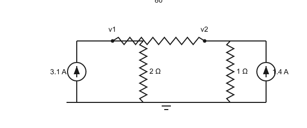

A. 5 V　B. 2 V　C. 3.1 V　D. 10 V

10. Superposition (see figure): a 3 V source (+ on top) in series with 6 Ω and 9 Ω forms a loop; a 2 A current source (arrow upward) is in parallel with the 9 Ω resistor. Let $i_x$ be the current through the 9 Ω resistor (downward positive). Use superposition to find $i_x$:

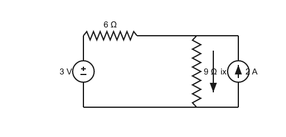

A. 0.2 A　B. 1.0 A　C. 1.2 A　D. 0.8 A

11. Thévenin (see figure): a 12 V source (+ on top) in series with 3 Ω; from the far node, one path goes through 6 Ω back to the source's negative terminal (reference b), and the other goes through 7 Ω to terminal a (a-b open). Then $V_{TH}$ is:

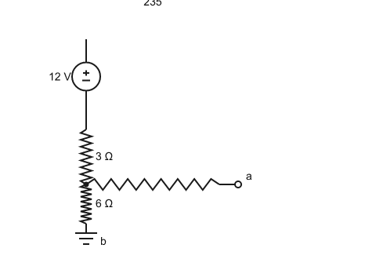

A. 6 V　B. 4 V　C. 8 V　D. 12 V

12. Using the previous network ($V_{TH}=8\,\mathrm{V}$, $R_{TH}=9\,\Omega$), the maximum power delivered to a load $R_L$ is:

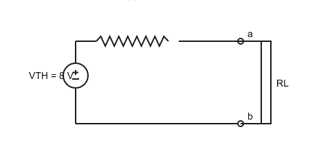

A. 0.89 W　B. 0.44 W　C. 3.56 W　D. 1.78 W

13. Inverting amplifier (see figure): $R_1=10\,\mathrm{k\Omega}$, $R_f=50\,\mathrm{k\Omega}$, $v_{in}=0.4\,\mathrm{V}$. The output $v_{out}$ is:

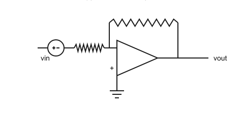

A. −5 V　B. +2 V　C. −2 V　D. −20 V

14. Schmitt trigger (see figure): $R_1=10\,\mathrm{k\Omega}$ between the output and the non-inverting input, $R_2=30\,\mathrm{k\Omega}$ between the non-inverting input and ground, saturation levels $\pm12\,\mathrm{V}$. The upper switching threshold is:

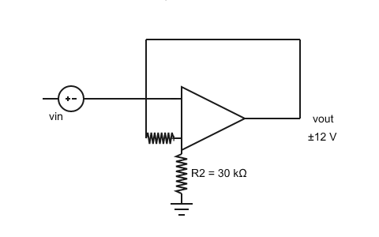

A. +3 V　B. +9 V　C. +12 V　D. +0.25 V

15. Summing amplifier (see figure): $R=20\,\mathrm{k\Omega}$, $R_f=40\,\mathrm{k\Omega}$, inputs $v_1=1\,\mathrm{V}$ and $v_2=0.5\,\mathrm{V}$. The output is:

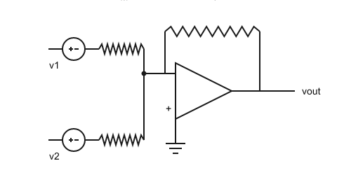

A. +3 V　B. +1.5 V　C. −1.5 V　D. −3 V

16. A $2\,\mu\mathrm{F}$ capacitor has $v(t)=10e^{-1000t}\,\mathrm{V}$ ($t\ge0$). The energy stored at $t=0$ is:
A. 200 µJ　B. 100 µJ　C. 50 µJ　D. 1 mJ

17. The equivalent inductance of $2\,\mathrm{H}$ and $3\,\mathrm{H}$ in parallel is:
A. 1.2 H　B. 0.833 H　C. 5 H　D. 6 H

18. An RC circuit is formed by $R=2\,\mathrm{k\Omega}$ and $C=10\,\mu\mathrm{F}$ (see figure). Its time constant $\tau$ is:

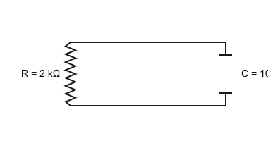

A. 5 ms　B. 20 ms　C. 200 ms　D. 50 ms

19. Source-free RC discharge (see figure): $v_C(0)=6\,\mathrm{V}$ and $\tau=20\,\mathrm{ms}$. The time at which $v_C$ first reaches $2\,\mathrm{V}$ is about:

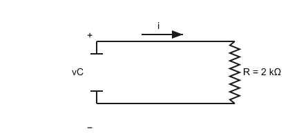

A. 40 ms　B. 10 ms　C. 22 ms　D. 20 ms

20. A $20u(t)\,\mathrm{V}$ source is in series with a $200\,\Omega$ resistor and a $4\,\mathrm{H}$ inductor (see figure). The inductor current at $t=8\,\mathrm{ms}$ is about:

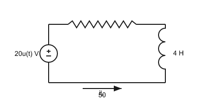

A. 63 mA　B. 100 mA　C. 33 mA　D. 10 mA

---

## Hints

- About 2 minutes per question: write the formula first, then substitute numbers.
- Watch out for: power signs, the numerator in the current-division formula, and how $R_{eq}$ is found for $\tau=R_{eq}C$.
- Upload your answers as "question number + option" (e.g. `1B 2D 3D …`); I will mark them question by question.
