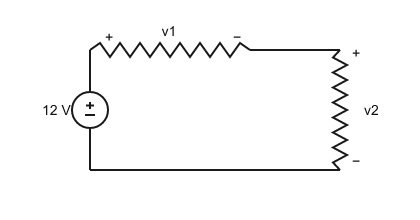
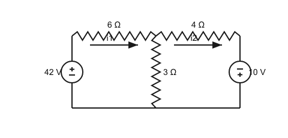
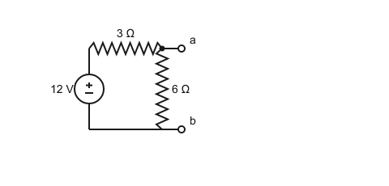
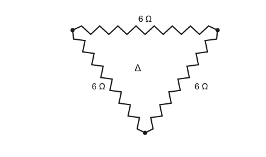
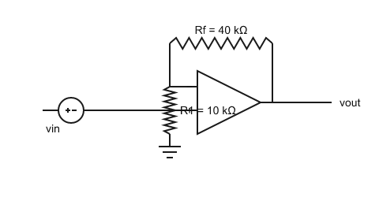
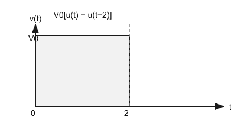

# EEE103 期中模拟卷（三）· 选择题补充版（中文版）

> **范围**：Week 1 – Week 7 中**模拟卷二未覆盖**的知识点
> **题量**：30 道选择题 ｜ **建议时间**：60 分钟（可拆成两次完成）｜ 每题 5 分
> **说明**：与模拟卷二合起来即完整覆盖期中考全部内容。完成后把答案上传给我批改。
> ⚠️ 本卷暂不提供答案。

---

## 第一部分 · Week 1 基础元件（第 1–5 题）

1. $0.048\,\mathrm{W}$ 用工程单位制（数值 1–999 + $10^{\pm3n}$ 词头）表示为：
A. 480 mW　B. 4.8 mW　C. 480 µW　D. 48 mW

2. 电子从左向右移动形成 $1\,\mathrm{mA}$ 电流，则**常规电流**的方向与大小为：
A. 右→左，1 mA　B. 左→右，1 mA　C. 左→右，2 mA　D. 右→左，2 mA

3. $5\,\Omega$ 电阻中流过 $2\,\mathrm{A}$ 电流，其消耗的功率为：
A. 10 W　B. 50 W　C. 20 W　D. 2.5 W

4. 一段均匀导线的电阻为 $R$。长度加倍、材料与截面积不变时，新电阻为：
A. $R/2$　B. $R$　C. $4R$　D. $2R$

5. $12\,\mathrm{V}$ 电池的容量为 $2\,\mathrm{Ah}$，其总储能为：
A. 24 Wh　B. 6 Wh　C. 24 J　D. 48 Wh

## 第二部分 · Week 2 电压电流定律（第 6–8 题）

6. 单回路电路（图）：12 V 电压源与两个电阻串联，已知其中一个电阻电压 $v_1=4\,\mathrm{V}$，则另一电阻电压 $v_2$ 为：

A. 8 V　B. 4 V　C. 12 V　D. 16 V

7. 两个理想电压源 $5\,\mathrm{V}$ 与 $3\,\mathrm{V}$ **同向串联**，其等效电压源为：
A. 2 V　B. 5 V　C. 8 V　D. 15 V

8. 下列哪种连接在电路模型中可能导致矛盾（不可能电路）：
A. 两个电压源串联　B. 两个电流源并联　C. 两个电阻串联　D. 两个不同电压源并联

## 第三部分 · Week 3 节点与网孔（第 9–13 题）

9. 节点分析中，参考节点通常优先选：
A. 电压最高的节点　B. 连接支路最多（或接地/底部）的节点　C. 电压源正端　D. 电流源所在节点

10. 两个非参考节点之间直接接一个电压源，节点分析的正确做法是：
A. 忽略该电压源　B. 把电压源替换为短路　C. 对「超节点」整体列 KCL，并补电压源电压约束方程　D. 把电压源替换为开路

11. 两个网孔之间夹一个电流源，网孔分析的正确做法是：
A. 沿「超网孔」外围列 KVL，并补电流源电流约束方程　B. 忽略电流源　C. 把电流源替换为短路　D. 把电流源替换为开路

12. 两网孔电路（图）：网孔 1 含 42 V 源（正极在上，位于左侧支路）、6 Ω（上方左段）与公共支路 3 Ω；网孔 2 含公共 3 Ω、4 Ω（上方右段）与 10 V 源（正极在下，位于右侧支路）。两网孔电流均取顺时针。求网孔电流 $i_1$：

A. 6 A　B. 2 A　C. 4 A　D. 12 A

13. 电路含较多独立**电流源**、独立电压源较少时，通常优先使用：
A. 节点分析法　B. 网孔分析法　C. 叠加定理　D. 戴维南定理

## 第四部分 · Week 4 常用技巧（第 14–16 题）

14. $9\,\mathrm{mA}$ 电流源与 $5\,\mathrm{k\Omega}$ 电阻并联，其等效电压源为：
A. 9 V 串联 5 kΩ　B. 1.8 mA 串联 5 kΩ　C. 45 V 并联 5 kΩ　D. 45 V 串联 5 kΩ

15. 诺顿定理（图）：12 V 源（正极在上）与 3 Ω 串联，6 Ω 并联在端子 a-b 之间。求诺顿电流 $I_N$（a-b 短路电流）：

A. 12 A　B. 6 A　C. 4 A　D. 2 A

16. 三个 $6\,\Omega$ 电阻接成三角形（Δ，图），等效星形（Y）每臂电阻为：

A. 2 Ω　B. 3 Ω　C. 6 Ω　D. 18 Ω

## 第五部分 · Week 5 运算放大器（第 17–21 题）

17. 理想运放的两条规则是：
A. 输入电流为零，且两输入端电压差为零　B. 输入电流为零，且输出电流为零　C. 输入电压为零，且输出电阻为零　D. 输入电流无穷大，且两输入端电压差为零

18. 同相放大器（图）：$R_1=10\,\mathrm{k\Omega}$（接地），$R_f=40\,\mathrm{k\Omega}$（反馈），$v_{in}=0.2\,\mathrm{V}$。输出 $v_{out}$ 为：

A. 0.8 V　B. 1 V　C. 5 V　D. 0.2 V

19. 两级反相放大器级联，增益分别为 $-2$ 与 $-3$，输入 $0.5\,\mathrm{V}$。输出为：
A. −3 V　B. −6 V　C. +3 V　D. +0.5 V

20. 比较器（开环）：参考电压 $2.5\,\mathrm{V}$ 接同相端，$v_{in}=1\,\mathrm{V}$ 接反相端，饱和电平 $\pm12\,\mathrm{V}$。输出为：
A. −12 V　B. +12 V　C. +2.5 V　D. 0 V

21. 电压跟随器（缓冲器）的输出为：
A. $v_{out}=-v_{in}$　B. $v_{out}=0$　C. $v_{out}=v_{in}$　D. $v_{out}=\left(1+\dfrac{R_f}{R_1}\right)v_{in}$

## 第六部分 · Week 6 电容与电感（第 22–26 题）

22. $2\,\mu\mathrm{F}$ 电容两端 $v(t)=10e^{-1000t}\,\mathrm{V}$（$t\ge0$）。$t=0$ 时的电流为：
A. +20 mA　B. 0　C. −2 mA　D. −20 mA

23. $3\,\mu\mathrm{F}$ 与 $6\,\mu\mathrm{F}$ 电容**串联**的等效电容为：
A. 9 µF　B. 0.5 µF　C. 2 µF　D. 18 µF

24. $100\,\mathrm{mH}$ 电感两端 $v_L=2e^{-3t}\,\mathrm{V}$，且 $i_L(-0.5\,\mathrm{s})=1\,\mathrm{A}$。则 $i_L(0)$ 约为：
A. 24.2 A　B. 30.9 A　C. 1 A　D. −5.7 A

25. 关于直流稳态与换路瞬间，正确的是：
A. 电容等效短路、电感等效开路；$v_C$、$i_L$ 可突变　B. 电容等效开路、电感等效短路；$v_C$、$i_L$ 不能突变　C. 电容等效开路、电感等效短路；$v_C$、$i_L$ 可突变　D. 都等效短路；都不能突变

26. 运放积分器（输入电阻 $R_1$、反馈电容 $C_F$）的输出与输入关系为：
A. $v_{out}=-R_1C_F\dfrac{dv_{in}}{dt}$　B. $v_{out}=-\dfrac{1}{R_1C_F}\displaystyle\int v_{in}\,dt$　C. $v_{out}=-\dfrac{R_1}{C_F}v_{in}$　D. $v_{out}=-\dfrac{1}{R_1C_F}\dfrac{dv_{in}}{dt}$

## 第七部分 · Week 7 RC/RL 电路（第 27–30 题）

27. 无源 RL 电路：$L=4\,\mathrm{H}$，$R=200\,\Omega$，$i_L(0)=0.1\,\mathrm{A}$。$t=20\,\mathrm{ms}$ 时的 $i_L$ 为：
A. 100 mA　B. 13.5 mA　C. 63.2 mA　D. 36.8 mA

28. 电压脉冲 $v(t)=V_0[u(t)-u(t-2)]$（图），$t=1\,\mathrm{s}$ 时 $v(t)$ 为：

A. $V_0$　B. 0　C. $2V_0$　D. $V_0/2$

29. 经过 $5\tau$ 后，一阶电路的暂态响应衰减到初值的：
A. 36.8%　B. 13.5%　C. 小于 1%　D. 5%

30. 有源 RC 电路：$v_C(0^+)=2\,\mathrm{V}$，$v_C(\infty)=10\,\mathrm{V}$，$\tau=5\,\mathrm{ms}$。$t=5\,\mathrm{ms}$ 时 $v_C$ 为：
A. 2.94 V　B. 7.06 V　C. 10 V　D. 8 V

---

## 答题提示

- 每题约 2 分钟；概念题看清选项表述，计算题先写公式。
- 高频陷阱：分流分子取另一支路、戴维南/诺顿求等效电阻时独立源要关断、$\tau$ 的 $R_{eq}$ 从储能元件看进去、比较器输出只有饱和电平。
- 完成后上传答案（题号 + 选项，如 `1D 2A 3C …`），我会逐题批改并出复盘练习。
