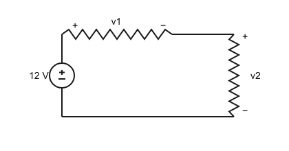
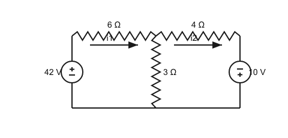
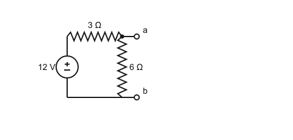
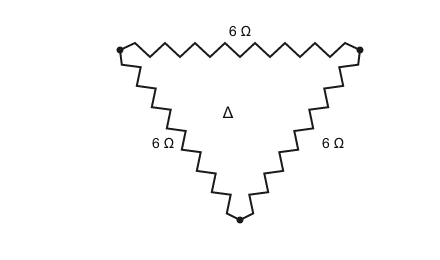
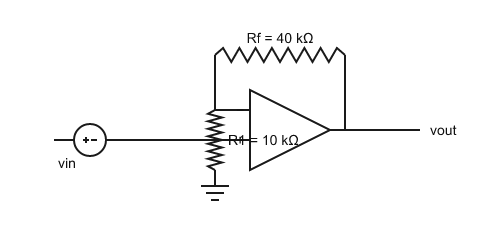
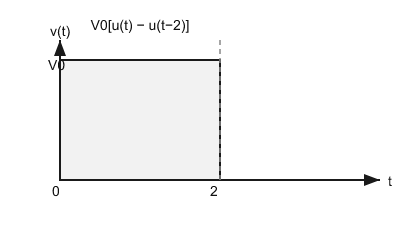

# EEE103 Midterm Mock (III) · Supplementary Multiple Choice (English)

> **Scope**: the topics of Week 1 – Week 7 **not covered** by Mock (II)
> **Format**: 30 multiple-choice questions ｜ **Suggested time**: 60 minutes (can be split into two sittings) ｜ 5 marks each
> **Note**: Together with Mock (II), this covers the entire midterm syllabus. Upload your answers when done; I will mark them and create review exercises.
> ⚠️ Answers are not provided in this paper yet.

---

## Part 1 · Week 1 Basic Components (Q1–5)

1. Expressed in engineering units (number 1–999 + a $10^{\pm3n}$ prefix), $0.048\,\mathrm{W}$ equals:
A. 480 mW　B. 4.8 mW　C. 480 µW　D. 48 mW

2. Electrons move from left to right, creating a current of $1\,\mathrm{mA}$. The **conventional current** direction and magnitude are:
A. right to left, 1 mA　B. left to right, 1 mA　C. left to right, 2 mA　D. right to left, 2 mA

3. A $5\,\Omega$ resistor carries $2\,\mathrm{A}$. The power it dissipates is:
A. 10 W　B. 50 W　C. 20 W　D. 2.5 W

4. A uniform wire has resistance $R$. If its length is doubled (same material and cross-section), the new resistance is:
A. $R/2$　B. $R$　C. $4R$　D. $2R$

5. A $12\,\mathrm{V}$ battery has a capacity of $2\,\mathrm{Ah}$. Its total stored energy is:
A. 24 Wh　B. 6 Wh　C. 24 J　D. 48 Wh

## Part 2 · Week 2 Voltage & Current Laws (Q6–8)

6. Single-loop circuit (see figure): a 12 V source in series with two resistors. If the voltage across one resistor is $v_1=4\,\mathrm{V}$, the voltage $v_2$ across the other is:

A. 8 V　B. 4 V　C. 12 V　D. 16 V

7. Two ideal voltage sources, $5\,\mathrm{V}$ and $3\,\mathrm{V}$, are connected in series with the **same polarity**. The equivalent source is:
A. 2 V　B. 5 V　C. 8 V　D. 15 V

8. Which connection can lead to a contradiction in the circuit model (an "impossible circuit")?
A. two voltage sources in series　B. two current sources in parallel　C. two resistors in series　D. two different voltage sources in parallel

## Part 3 · Week 3 Nodal & Mesh (Q9–13)

9. In nodal analysis, the reference node is usually chosen as:
A. the node with the highest voltage　B. the node with the most connections (or the ground/bottom node)　C. the positive terminal of a voltage source　D. the node of a current source

10. When a voltage source connects two non-reference nodes, the correct nodal-analysis approach is:
A. ignore the source　B. replace the source with a short circuit　C. apply KCL to the "supernode" and add the voltage-source constraint equation　D. replace the source with an open circuit

11. When a current source lies between two meshes, the correct mesh-analysis approach is:
A. apply KVL around the "supermesh" and add the current-source constraint equation　B. ignore the source　C. replace the source with a short circuit　D. replace the source with an open circuit

12. Two-mesh circuit (see figure): mesh 1 contains a 42 V source (+ on top, left branch), 6 Ω (top-left) and the shared 3 Ω; mesh 2 contains the shared 3 Ω, 4 Ω (top-right) and a 10 V source (+ at the bottom, right branch). Both mesh currents are clockwise. Find $i_1$:

A. 6 A　B. 2 A　C. 4 A　D. 12 A

13. For a circuit with many independent **current sources** and few independent voltage sources, the preferred method is:
A. nodal analysis　B. mesh analysis　C. superposition　D. Thévenin's theorem

## Part 4 · Week 4 Handy Techniques (Q14–16)

14. A $9\,\mathrm{mA}$ current source in parallel with $5\,\mathrm{k\Omega}$ is equivalent to:
A. 9 V in series with 5 kΩ　B. 1.8 mA in series with 5 kΩ　C. 45 V in parallel with 5 kΩ　D. 45 V in series with 5 kΩ

15. Norton (see figure): a 12 V source (+ on top) in series with 3 Ω, and a 6 Ω resistor across terminals a-b. Find the Norton current $I_N$ (the a-b short-circuit current):

A. 12 A　B. 6 A　C. 4 A　D. 2 A

16. Three $6\,\Omega$ resistors form a delta (Δ, see figure). Each arm of the equivalent wye (Y) is:

A. 2 Ω　B. 3 Ω　C. 6 Ω　D. 18 Ω

## Part 5 · Week 5 Operational Amplifier (Q17–21)

17. The two ideal op-amp rules are:
A. no input current, and zero voltage difference between the inputs　B. no input current, and no output current　C. zero input voltage, and zero output resistance　D. infinite input current, and zero voltage difference between the inputs

18. Non-inverting amplifier (see figure): $R_1=10\,\mathrm{k\Omega}$ (to ground), $R_f=40\,\mathrm{k\Omega}$ (feedback), $v_{in}=0.2\,\mathrm{V}$. The output $v_{out}$ is:

A. 0.8 V　B. 1 V　C. 5 V　D. 0.2 V

19. Two inverting amplifiers are cascaded with gains $-2$ and $-3$. With an input of $0.5\,\mathrm{V}$, the output is:
A. −3 V　B. −6 V　C. +3 V　D. +0.5 V

20. Comparator (open loop): a reference of $2.5\,\mathrm{V}$ is on the non-inverting input, $v_{in}=1\,\mathrm{V}$ is on the inverting input, saturation levels $\pm12\,\mathrm{V}$. The output is:
A. −12 V　B. +12 V　C. +2.5 V　D. 0 V

21. The output of a voltage follower (buffer) is:
A. $v_{out}=-v_{in}$　B. $v_{out}=0$　C. $v_{out}=v_{in}$　D. $v_{out}=\left(1+\dfrac{R_f}{R_1}\right)v_{in}$

## Part 6 · Week 6 Capacitors & Inductors (Q22–26)

22. A $2\,\mu\mathrm{F}$ capacitor has $v(t)=10e^{-1000t}\,\mathrm{V}$ ($t\ge0$). The current at $t=0$ is:
A. +20 mA　B. 0　C. −2 mA　D. −20 mA

23. The equivalent capacitance of $3\,\mu\mathrm{F}$ and $6\,\mu\mathrm{F}$ in **series** is:
A. 9 µF　B. 0.5 µF　C. 2 µF　D. 18 µF

24. A $100\,\mathrm{mH}$ inductor has $v_L=2e^{-3t}\,\mathrm{V}$ and $i_L(-0.5\,\mathrm{s})=1\,\mathrm{A}$. Then $i_L(0)$ is about:
A. 24.2 A　B. 30.9 A　C. 1 A　D. −5.7 A

25. Regarding DC steady state and switching instants, the correct statement is:
A. capacitor → short circuit, inductor → open circuit; $v_C$ and $i_L$ may jump　B. capacitor → open circuit, inductor → short circuit; $v_C$ and $i_L$ cannot jump　C. capacitor → open circuit, inductor → short circuit; $v_C$ and $i_L$ may jump　D. both → short circuit; neither can jump

26. For an op-amp integrator (input resistor $R_1$, feedback capacitor $C_F$), the output-input relation is:
A. $v_{out}=-R_1C_F\dfrac{dv_{in}}{dt}$　B. $v_{out}=-\dfrac{1}{R_1C_F}\displaystyle\int v_{in}\,dt$　C. $v_{out}=-\dfrac{R_1}{C_F}v_{in}$　D. $v_{out}=-\dfrac{1}{R_1C_F}\dfrac{dv_{in}}{dt}$

## Part 7 · Week 7 RC/RL Circuits (Q27–30)

27. Source-free RL circuit: $L=4\,\mathrm{H}$, $R=200\,\Omega$, $i_L(0)=0.1\,\mathrm{A}$. The current $i_L$ at $t=20\,\mathrm{ms}$ is:
A. 100 mA　B. 13.5 mA　C. 63.2 mA　D. 36.8 mA

28. For the voltage pulse $v(t)=V_0[u(t)-u(t-2)]$ (see figure), $v(t)$ at $t=1\,\mathrm{s}$ is:

A. $V_0$　B. 0　C. $2V_0$　D. $V_0/2$

29. After $5\tau$, the transient response of a first-order circuit has decayed to:
A. 36.8%　B. 13.5%　C. less than 1%　D. 5%

30. Driven RC circuit: $v_C(0^+)=2\,\mathrm{V}$, $v_C(\infty)=10\,\mathrm{V}$, $\tau=5\,\mathrm{ms}$. Then $v_C$ at $t=5\,\mathrm{ms}$ is:
A. 2.94 V　B. 7.06 V　C. 10 V　D. 8 V

---

## Hints

- About 2 minutes per question: for calculations write the formula first, then substitute.
- Frequent traps: the current-division numerator is the OTHER branch; turn off independent sources when finding $R_{TH}/R_N$; $R_{eq}$ for $\tau$ is seen from the storage element; a comparator's output is only at the saturation levels.
- Upload your answers as "question number + option" (e.g. `1D 2A 3C …`); I will mark them question by question.
