# Week 1 · 基础元件与电路
# Basic Components and Electric Circuits

> 对应讲义：`Lecture/Week1_Basic Components and Electric Circuits_preview.pdf`

---

## 1. 单位与量纲 / Units and Scale

### 1.1 国际单位制 SI System（国际单位制）

任何可测量量的值都必须**同时包含数值和单位**（a number and a unit）。七个基本单位（Base units）：

| 量 Quantity | 单位 Unit | 符号 |
|---|---|---|
| 长度 length | metre 米 | m |
| 质量 mass | kilogram 千克 | kg |
| 时间 time | second 秒 | s |
| 电流 current | ampere 安培 | A |
| 温度 temperature | kelvin 开尔文 | K |
| 物质的量 amount | mole 摩尔 | mol |
| 发光强度 luminous intensity | candela 坎德拉 | cd |

**导出单位** Derived units（由基本单位组合）：
- 功/能量 work/energy：焦耳 joule (J)，$1\,\mathrm{J}=1\,\mathrm{kg\,m^2\,s^{-2}}$
- 功率 power：瓦特 watt (W)，$1\,\mathrm{W}=1\,\mathrm{J/s}$

### 1.2 工程单位制 Engineering Units（工程单位）

工程上习惯：**数值取 1–999 之间**，配上**按 3 的倍数**取幂的十进制词头（metric prefix，$10^{\pm3n}$）。

| 词头 Prefix | 符号 | 倍数 |
|---|---|---|
| pico 皮 | p | $10^{-12}$ |
| nano 纳 | n | $10^{-9}$ |
| micro 微 | µ | $10^{-6}$ |
| milli 毫 | m | $10^{-3}$ |
| （基本） | — | $1$ |
| kilo 千 | k | $10^{3}$ |
| mega 兆 | M | $10^{6}$ |
| giga 吉 | G | $10^{9}$ |
| tera 太 | T | $10^{12}$ |

> 例 Example：$0.048\,\mathrm{W} = 48\,\mathrm{mW}$（毫瓦）

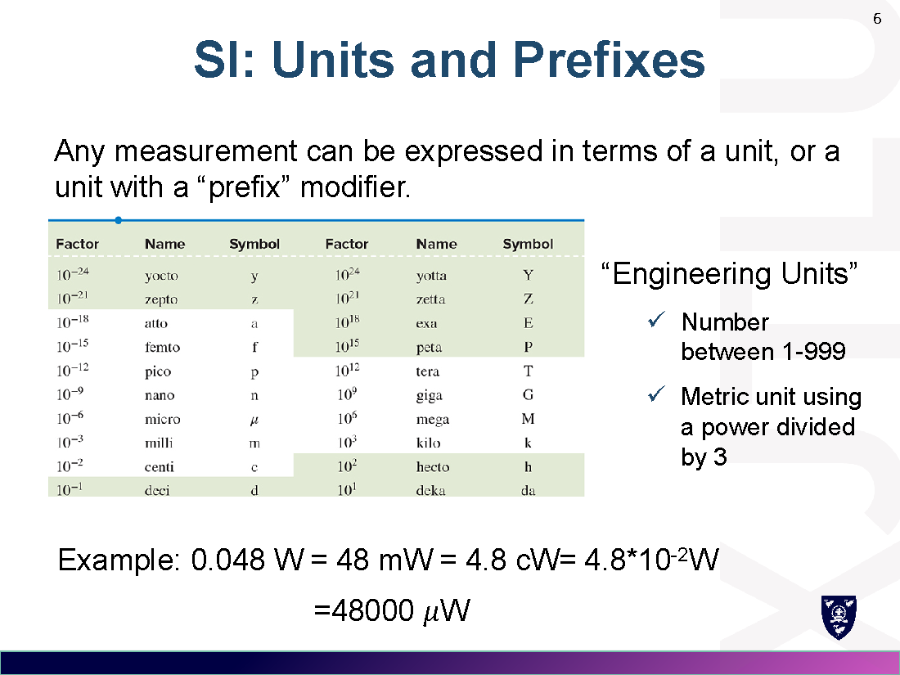

---

## 2. 电荷与电流 / Charge and Current

### 2.1 电荷 Charge（电荷）

- 符号 Symbol：$Q$ 或 $q$；单位：库仑 coulomb (C)
- 最小电荷：电子 $-1.602\times10^{-19}\,\mathrm{C}$，质子 $+1.602\times10^{-19}\,\mathrm{C}$
- **电荷守恒**：既不能被创造，也不能被消灭（neither created nor destroyed）。

### 2.2 电流 Current（电流）

- 符号：$I$ 或 $i$；单位：安培 ampere (A)
- 电流是**电荷流动的速率**（rate of charge flow）：
$$i=\frac{dq}{dt} \qquad 1\,\mathrm{A}=1\,\mathrm{C/s}$$
- 积分形式：
$$q(t)=\int_{t_0}^{t} i\,dt' + q(t_0)$$

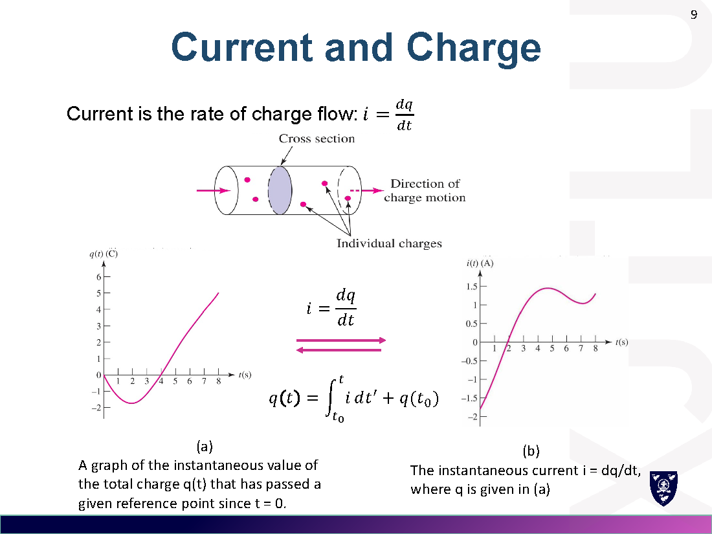

### 2.3 常规电流 vs 电子流 Conventional vs Electron Current

- **电子流模型**：电子从电源负极流向正极。
- **常规电流**（conventional current）：历史上假设"正电荷"携带电流，方向与电子流**相反**。
- 解题统一用**常规电流方向**。

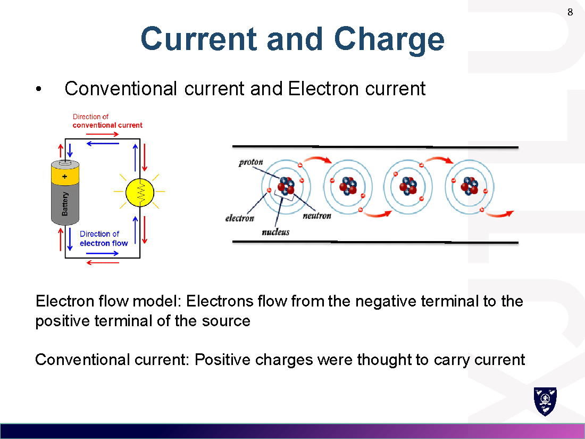

### 2.4 电流的类型 Types of Current

(a) 直流 DC；(b) 正弦（交流）sinusoidal AC；(c) 指数 exponential；(d) 衰减正弦 damped sinusoidal。

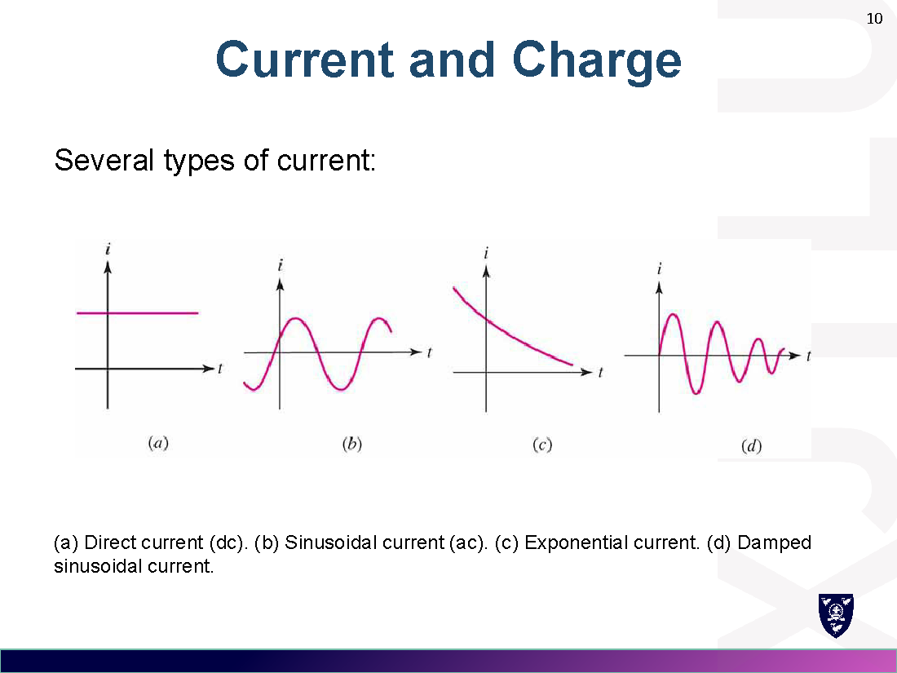

### 2.5 电流的标注 Current Designation

电流必须同时标明**方向（箭头）和大小**。同一电流有两种等价表示（箭头反向则数值取负）。

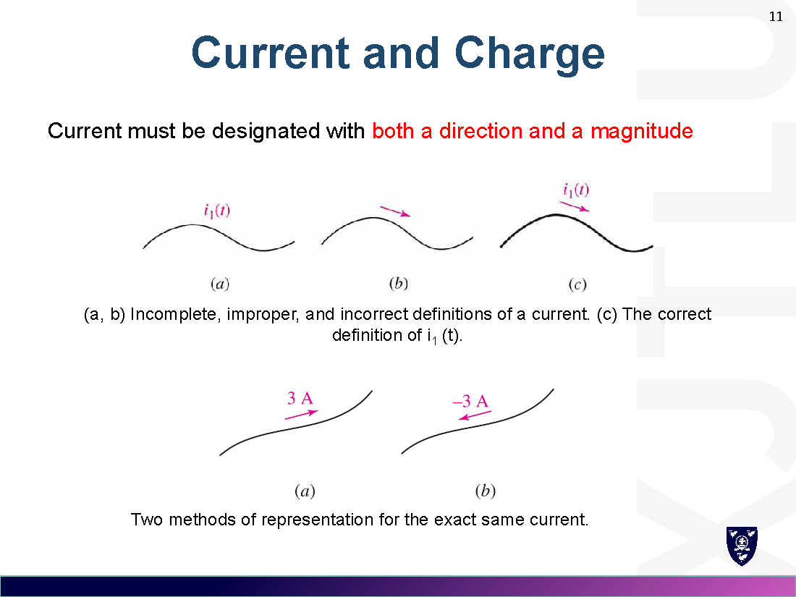

> 例 Example：电子从左向右移动形成 1 mA 电流 → 电流方向为右向左，$I_1=-1\,\mathrm{mA},\ I_2=+1\,\mathrm{mA}$。

---

## 3. 电压 Voltage（电压）

- 符号：$V$ 或 $v$；单位：伏特 volt (V)
- 定义：把 1 C 电荷从 A 移到 B 需做 1 J 的功，则 A、B 之间电压为 1 伏。
- 电压必须同时标明**大小和极性**（magnitude and polarity）。
- 电路元件（circuit element）通常有两个端子，其 **v-i 关系**定义了该元件模型。

---

## 4. 功率与能量 / Power and Energy

### 4.1 功率 Power（功率）

- 符号：$P$ 或 $p$；单位：瓦特 watt (W)
- $$p = vi \quad(\mathrm{J/s = W})$$
- **被动符号约定** Passive sign convention：电流箭头从元件的 **+ 端**流入。
- $p>0$：元件**吸收**能量（absorbing）；$p<0$：元件**提供**能量（supplying）。

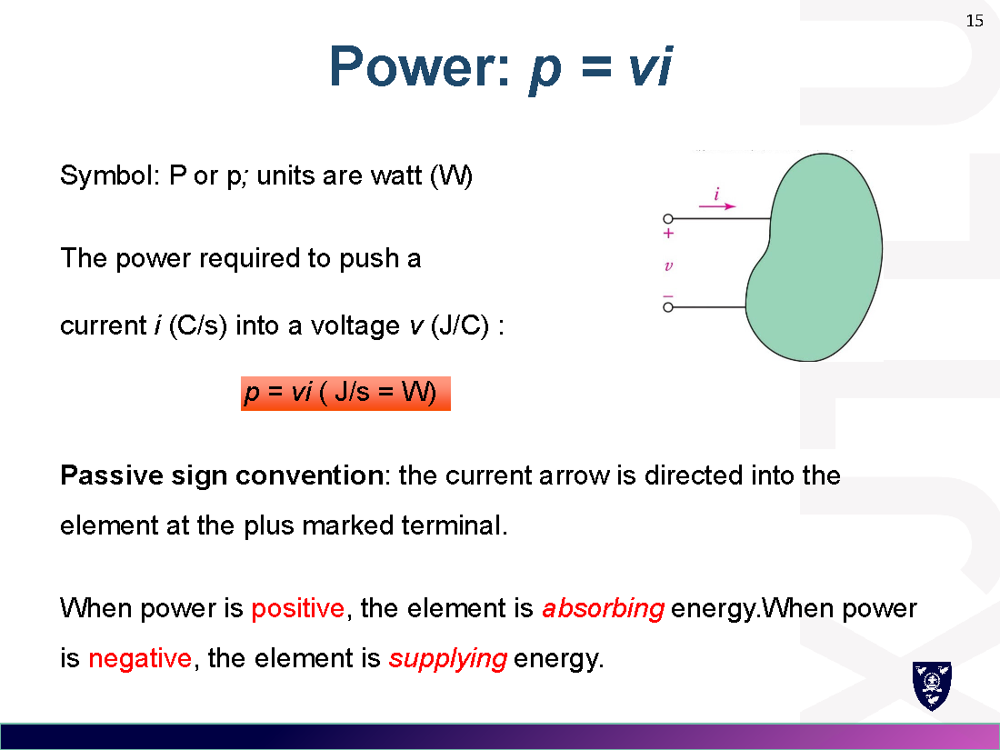

> 例：$2\,\mathrm{V}\times3\,\mathrm{A}=6\,\mathrm{W}$（吸收）；$4\,\mathrm{V}\times(-5\,\mathrm{A})=-20\,\mathrm{W}$（实际在供电）。

### 4.2 能量 Energy（能量）

- 符号：$W$ 或 $w$；单位：焦耳 joule (J)
- 能量是功率的积分：
$$w(t)=\int_{t_0}^{t} p\,dt=\int_{t_0}^{t} vi\,dt$$
- 常用单位：瓦时 watt-hour (Wh)：$1\,\mathrm{Wh}=3600\,\mathrm{J}$；千瓦时：$1\,\mathrm{kWh}=3.6\times10^6\,\mathrm{J}$
- 电池能量 Battery：$w=V\times(\text{capacity in Ah})$；如 1.5 V × 2 Ah = 3 Wh。

---

## 5. 独立源与受控源 / Independent & Dependent Sources

### 5.1 独立电压源 Independent Voltage Source

- 理想电压源维持端电压 $v_s$ 恒定；**电流由外电路决定**；无电流限制。

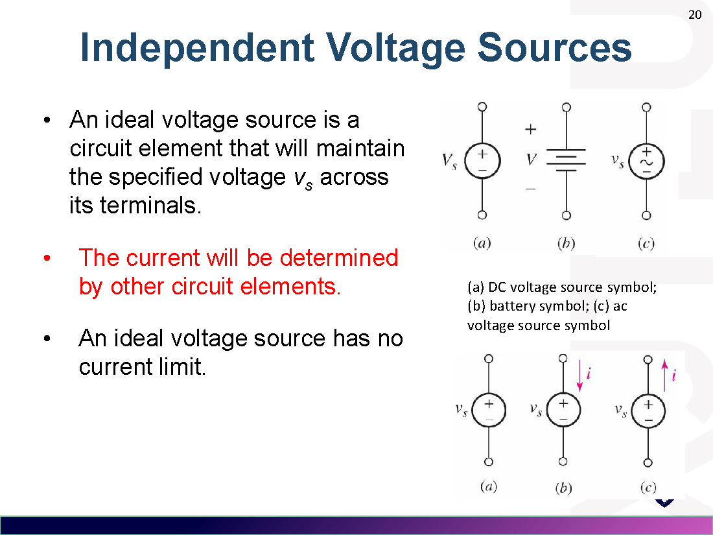

### 5.2 独立电流源 Independent Current Source

- 理想电流源维持输出电流 $i_s$ 恒定；**电压由外电路决定**（$V\neq0$）。

### 5.3 受控源 Dependent (Controlled) Sources（受控源/依赖源）

受控源的输出由电路中**其它变量**决定，四种类型：

| 类型 | 英文 | 受控量 | 比例系数 |
|---|---|---|---|
| 电压控制电压源 | VCVS | $v_2$ 控制电压 | $\mu$（无量纲） |
| 电压控制电流源 | VCCS | $v$ 控制电流 | $g$（A/V，西门子） |
| 电流控制电压源 | CCVS | $i$ 控制电压 | $r$（V/A，欧姆） |
| 电流控制电流源 | CCCS | $i$ 控制电流 | $\beta$（无量纲） |

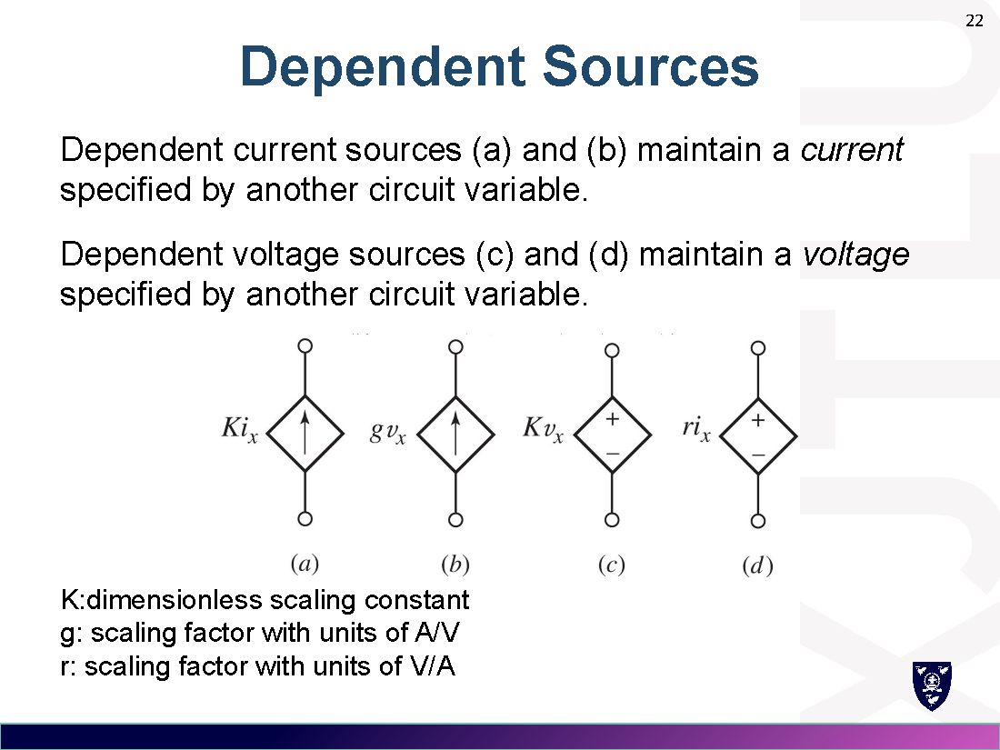

> 例 Example：已知 $v_2=3\,\mathrm{V}$，求 $v_L$。$v_L = 5v_2 = 5\times3 = 15\,\mathrm{V}$。

---

## 6. 网络与电路 / Networks and Circuits

- **网络** Network：两个或更多简单元件的互连。
- **电路** Circuit：至少含一条**闭合路径**的网络。
- 注意：每个电路都是网络，但**不是所有网络都是电路**。

---

## 7. 电阻与欧姆定律 / Resistors & Ohm's Law

### 7.1 基本元件 Basic Components

四种基本元件：电阻 R、电容 C、电感 L、电源 source。

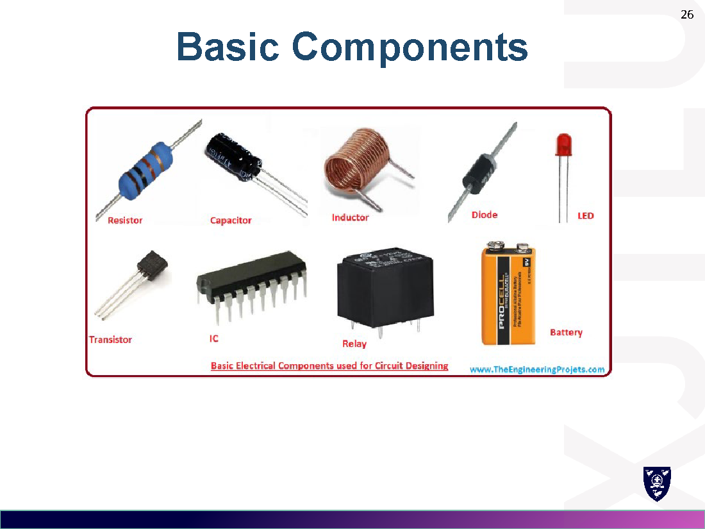

### 7.2 欧姆定律 Ohm's Law（欧姆定律）

对**线性电阻**：
$$v = iR$$
- $R$：电阻 resistance，单位欧姆 ohm (Ω)，$1\,\Omega=1\,\mathrm{V/A}$
- 伏安特性为过原点的直线（斜率 = $1/R$）

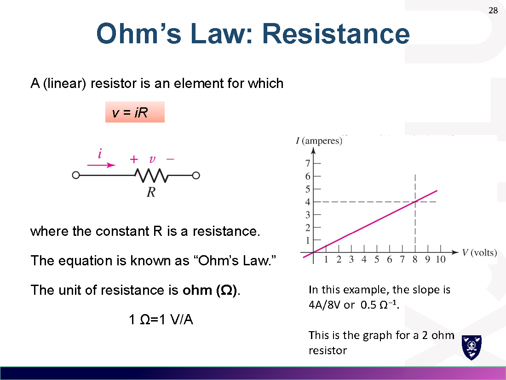

### 7.3 电阻吸收功率 Power Absorption

电阻恒吸收功率（passive sign convention 下 $p>0$）：
$$p = vi = \frac{v^2}{R} = i^2R$$

### 7.4 欧姆定律公式圆 Ohm's Law Formulas

$$v=iR,\qquad i=\frac{v}{R},\qquad R=\frac{v}{i},\qquad p=vi=\frac{v^2}{R}=i^2R$$

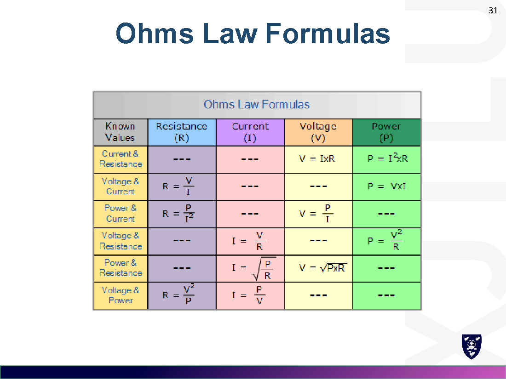

### 7.5 电阻率 Resistivity（电阻率）

$$R = \rho\,\frac{l}{A}$$
- $\rho$：电阻率；$l$：长度；$A$：截面积。
- 多数情况下导线电阻可近似为 0。

### 7.6 电导 Conductance（电导）

$$G = \frac{1}{R} \quad(\text{单位西门子 siemens, S})$$
欧姆定律可写作：$i = Gv$。

---

## 8. 开路与短路 / Open & Short Circuits

| 状态 | 电流 | 电压 | 等效电阻 |
|---|---|---|---|
| 开路 Open circuit | $I=0$ | 任意值 | $R=\infty$ |
| 短路 Short circuit | 任意值 | $v=0$ | $R=0$ |

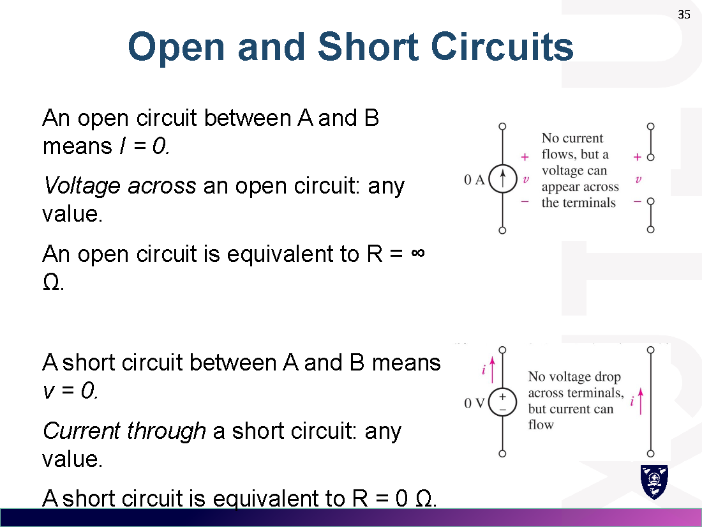

---

## 9. 易错点 / Common Mistakes

1. **电流方向**：常规电流与电子流方向相反，别用反。
2. **被动符号约定**：$p=vi$ 中 $i$ 必须从 $+$ 端流入；若方向相反，$p$ 要取负号。
3. **受控源是"电源"**：它吸收或提供功率，不能当普通电阻处理。
4. **工程单位**：换算时按 $10^{\pm3}$ 跳档（如 0.048 W = 48 mW，而非 4.8 cW）。
5. 开路≠"没有电压"，短路≠"没有电流"。

---

## 10. 公式速查 / Formula Summary

$$i=\frac{dq}{dt},\quad q(t)=\int i\,dt'+q(t_0),\quad v=iR,\quad G=\frac1R$$
$$p=vi=\frac{v^2}{R}=i^2R,\quad w=\int p\,dt,\quad R=\rho\frac{l}{A}$$
$$1\,\mathrm{J}=1\,\mathrm{W\cdot s},\quad 1\,\mathrm{Wh}=3600\,\mathrm{J}$$
