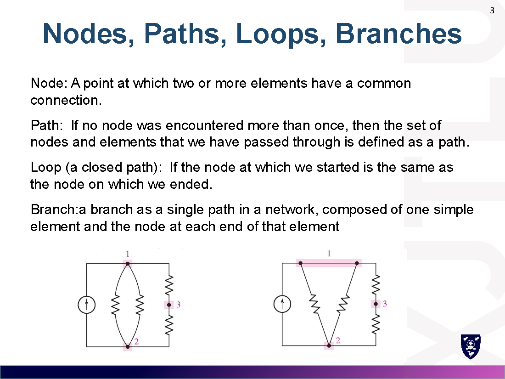
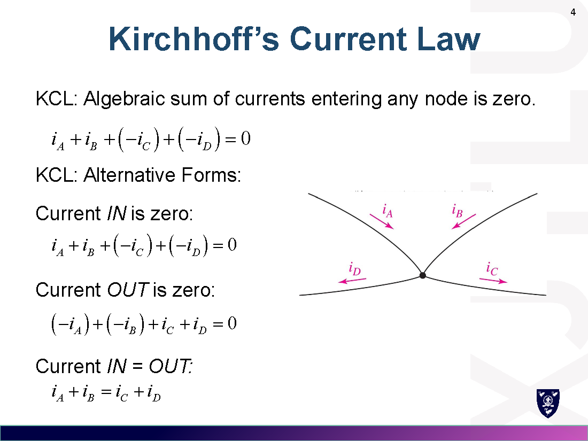
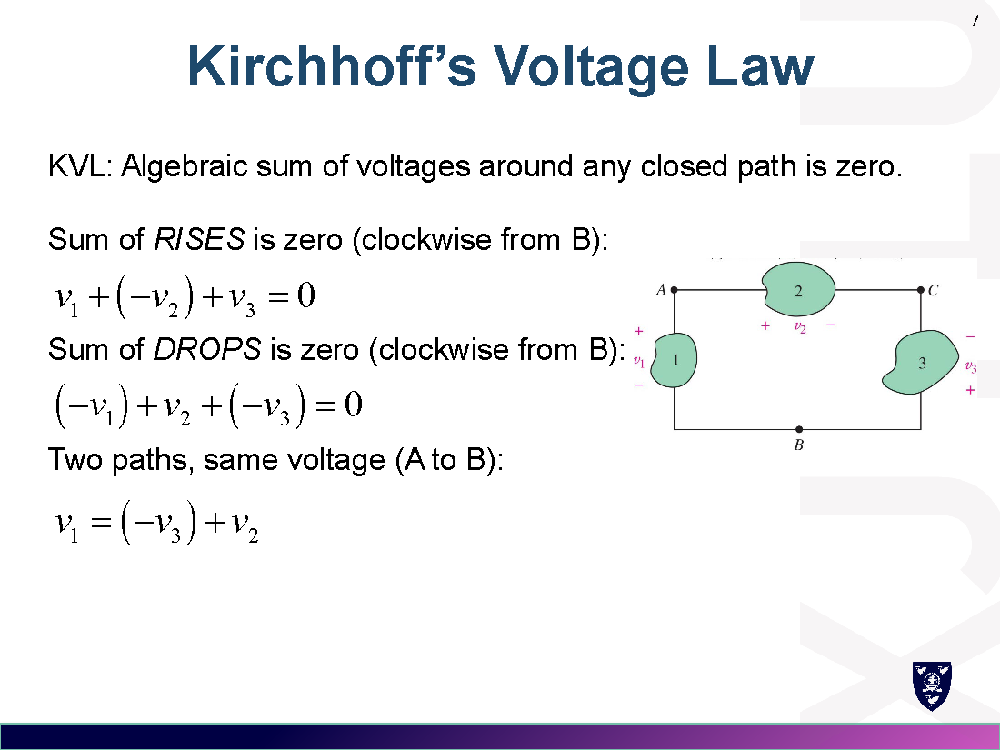
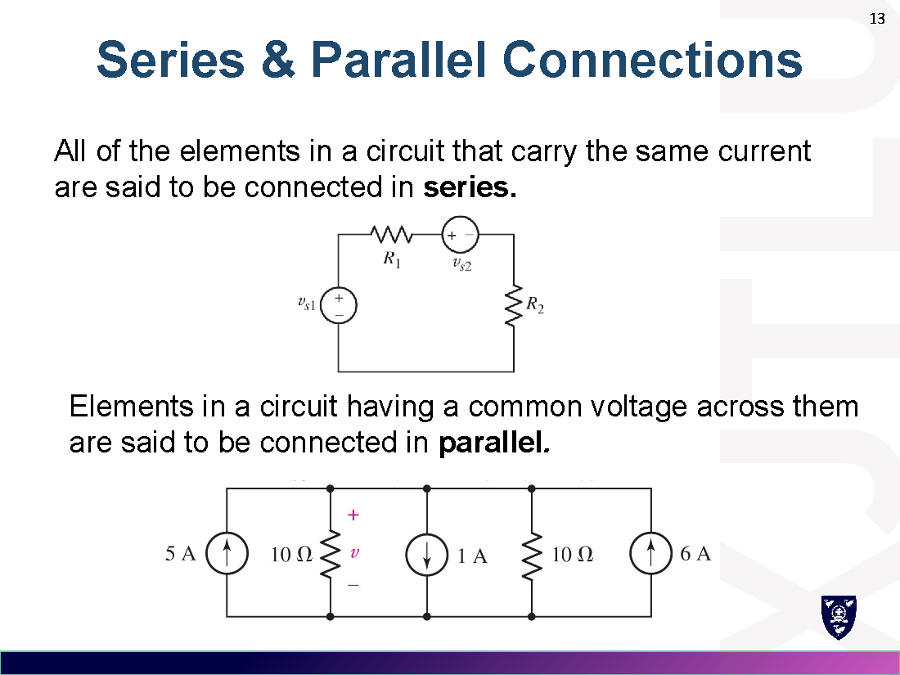
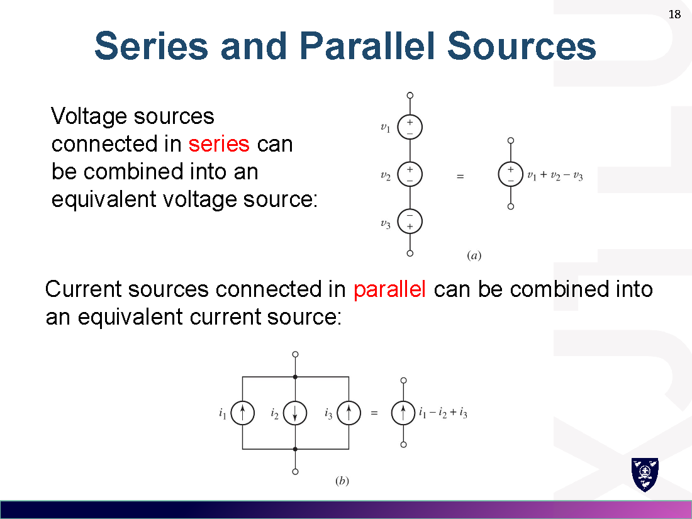
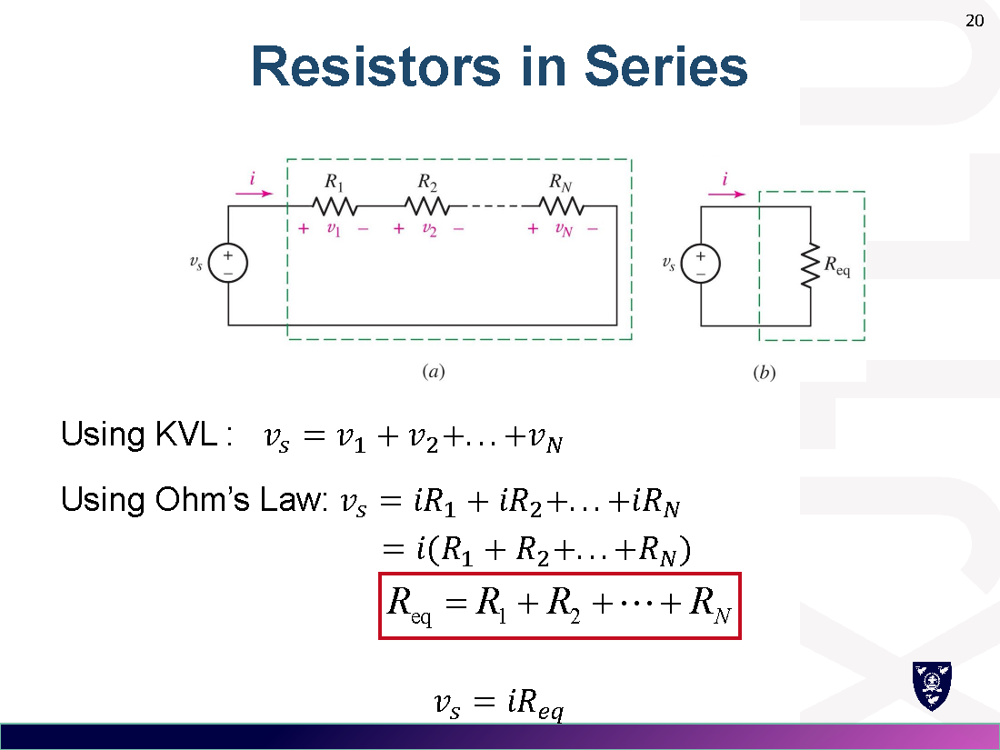
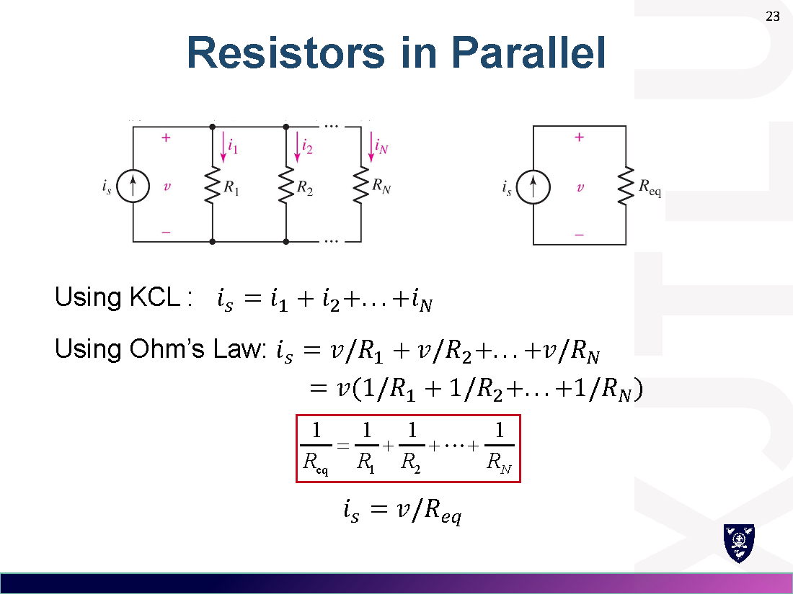
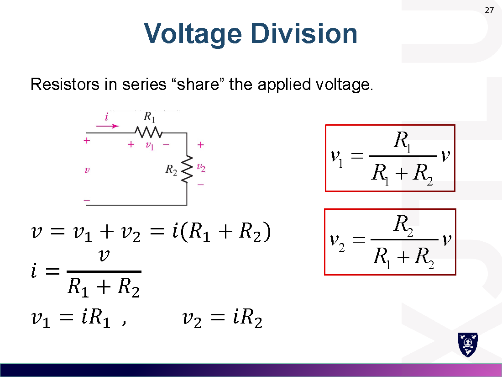
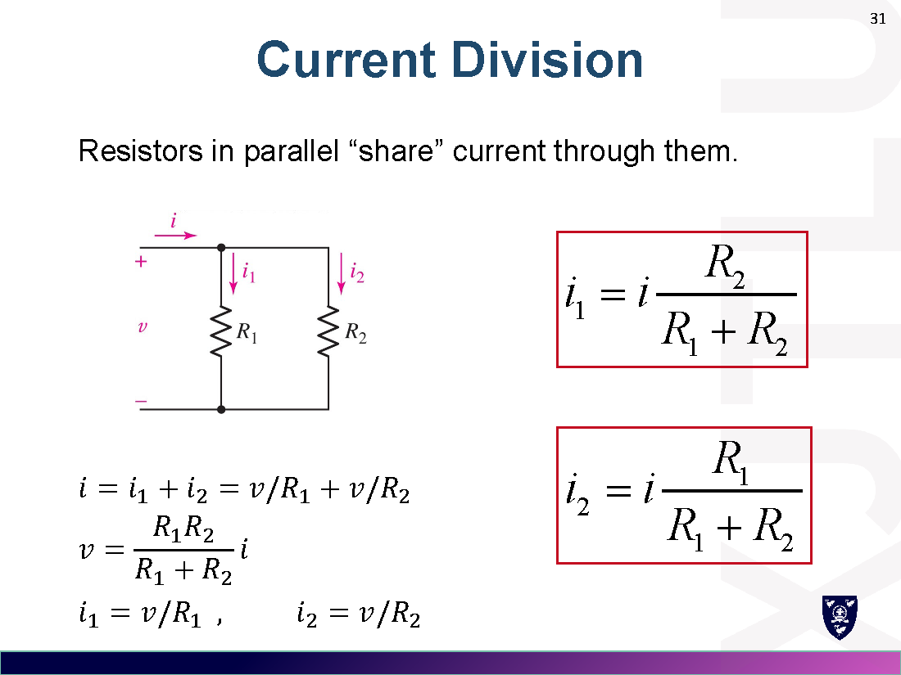
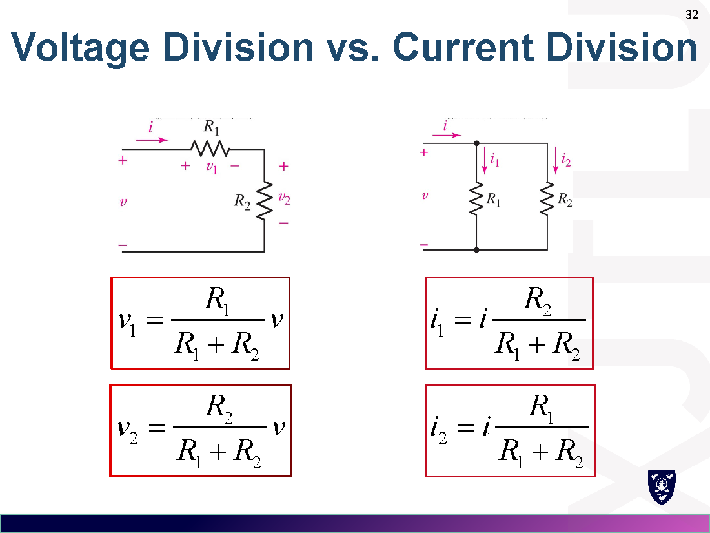

# Week 2 · 电压与电流定律
# Voltage and Current Laws

> 对应讲义：`Lecture/Week2-Voltage and Current Laws_preview.pdf`

---

## 1. 拓扑概念 / Nodes, Paths, Loops, Branches

| 术语 Term | 中文 | 定义 Definition |
|---|---|---|
| Node | 节点 | 两个及以上元件共同连接的点 |
| Path | 路径 | 经过的节点不重复的一组节点与元件 |
| Loop | 回路 | 起点与终点相同的**闭合路径** |
| Branch | 支路 | 由单个元件及其两端节点组成的单一路径 |

---

## 2. 基尔霍夫电流定律 KCL（基尔霍夫电流定律）

**流入任一节点的电流代数和为零**（Algebraic sum of currents entering any node is zero）：

$$i_A+i_B+(-i_C)+(-i_D)=0$$

三种等价形式：
- 流入 = 0：$i_A+i_B-i_C-i_D=0$
- 流出 = 0：$-i_A-i_B+i_C+i_D=0$
- **流入 = 流出**：$i_A+i_B=i_C+i_D$

> 例 Example：电压源提供 3 A，$R_2$ 中电流 2 A，求 $R_3$ 电流。$i_R1 - 2 - i + 5 = 0 \Rightarrow i = 6\,\mathrm{A}$。

---

## 3. 基尔霍夫电压定律 KVL（基尔霍夫电压定律）

**沿任一闭合回路的电压代数和为零**（Algebraic sum of voltages around any closed path is zero）：

$$\text{Sum of RISES}=0:\quad v_1+(-v_2)+v_3=0$$
$$\text{Sum of DROPS}=0:\quad (-v_1)+v_2+(-v_3)=0$$

> 技巧：任选绕行方向，**电压升（rises）为正**或**电压降（drops）为正**，只要全回路统一即可。

> 例 Example：求 $v_{R2}$。对 loop 1（从 c 出发）：$4-36+v_{R2}=0 \Rightarrow v_{R2}=32\,\mathrm{V}$。

---

## 4. 串联与并联 / Series & Parallel Connections

- **串联 Series**：元件**电流相同**（carry the same current）。
- **并联 Parallel**：元件**电压相同**（common voltage across them）。

### 4.1 单回路电路 Single-Loop Circuit

回路中电流处处相同，用 KVL + 欧姆定律求解。

### 4.2 单节点对电路 Single-Node-Pair Circuit

同一对节点电压相同，用 KCL + 欧姆定律求解。

---

## 5. 电源的串并联 / Series & Parallel Sources

- **电压源串联**可合并为等效电压源（代数和）。
- **电流源并联**可合并为等效电流源（代数和）。

> **不可能电路** Impossible circuits：电压源并联、电流源串联会导致模型上的物理矛盾。

---

## 6. 电阻串并联 / Resistors in Series & Parallel

### 6.1 电阻串联 Series

$$R_{eq}=R_1+R_2+\cdots+R_N$$

### 6.2 电阻并联 Parallel

$$\frac{1}{R_{eq}}=\frac{1}{R_1}+\frac{1}{R_2}+\cdots+\frac{1}{R_N}$$

### 6.3 两个电阻并联 Two Resistors in Parallel（乘积/和）

$$R_{eq}=R_1 \parallel R_2=\frac{R_1 R_2}{R_1+R_2}$$

> 并联总电阻**小于**任一支路电阻。

---

## 7. 分压 / Voltage Division（分压）

串联电阻"分享"电压：

$$v_1=\frac{R_1}{R_1+R_2}\,v,\qquad v_2=\frac{R_2}{R_1+R_2}\,v$$

> 例 Example：求 $v_x$。先算并联 $R_{eq}=\dfrac{R_1R_2}{R_1+R_2}=2\,\Omega$，再分压 $v_x=10\times\dfrac{2}{2+3+5}=2\,\mathrm{V}$。

---

## 8. 分流 / Current Division（分流）

并联电阻"分享"电流（注意：**分子是另一支路的电阻**）：

$$i_1=\frac{R_2}{R_1+R_2}\,i,\qquad i_2=\frac{R_1}{R_1+R_2}\,i$$

### 8.1 分压 vs 分流对比 Voltage vs Current Division

| | 分压 Voltage division | 分流 Current division |
|---|---|---|
| 适用 | 串联电阻 | 并联电阻 |
| 公式 | $v_1=\dfrac{R_1}{R_1+R_2}v$ | $i_1=\dfrac{R_2}{R_1+R_2}i$ |
| 注意 | 分子是自己 | 分子是**对方** |

---

## 9. 易错点 / Common Mistakes

1. **分流公式**：$i_1$ 的分子是 $R_2$（另一条支路），与分压公式相反。
2. KCL 列方程时，电流方向要带符号（流入为正则流出为负）。
3. KVL 绕行方向与元件极性要一致（先标电压极性再列式）。
4. 两个电阻并联用"乘积/和"，别和串联混。
5. 电压源不能并联、电流源不能串联（模型上矛盾）。

---

## 10. 公式速查 / Formula Summary

$$\text{KCL: } \sum i_{node}=0 \qquad \text{KVL: } \sum v_{loop}=0$$
$$\text{串联: } R_{eq}=\sum R_i \qquad \text{并联: } \frac{1}{R_{eq}}=\sum\frac{1}{R_i} \qquad R_1\parallel R_2=\frac{R_1R_2}{R_1+R_2}$$
$$\text{分压: } v_1=\frac{R_1}{R_1+R_2}v \qquad \text{分流: } i_1=\frac{R_2}{R_1+R_2}i$$
