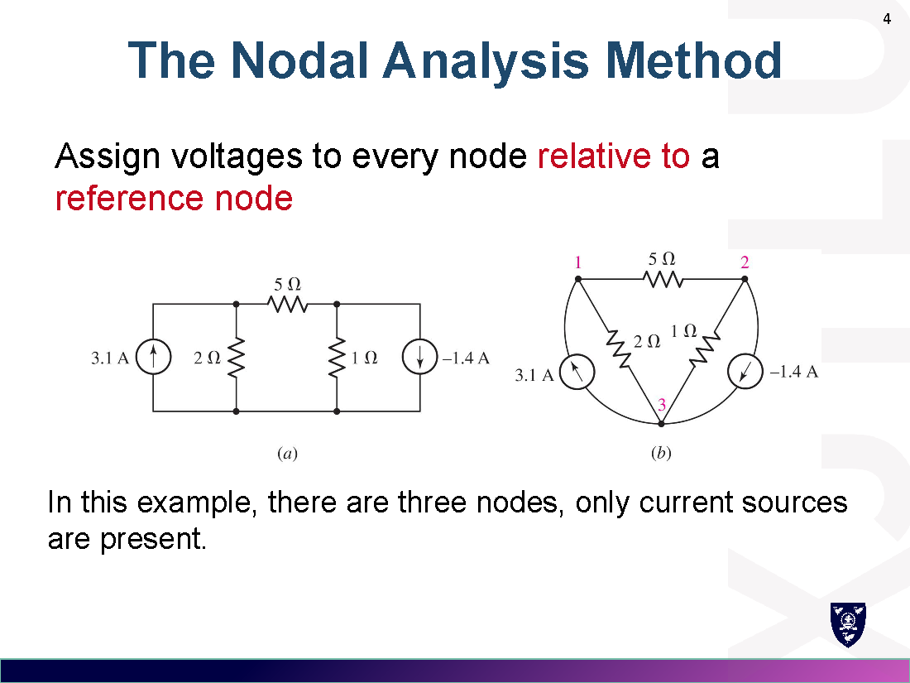
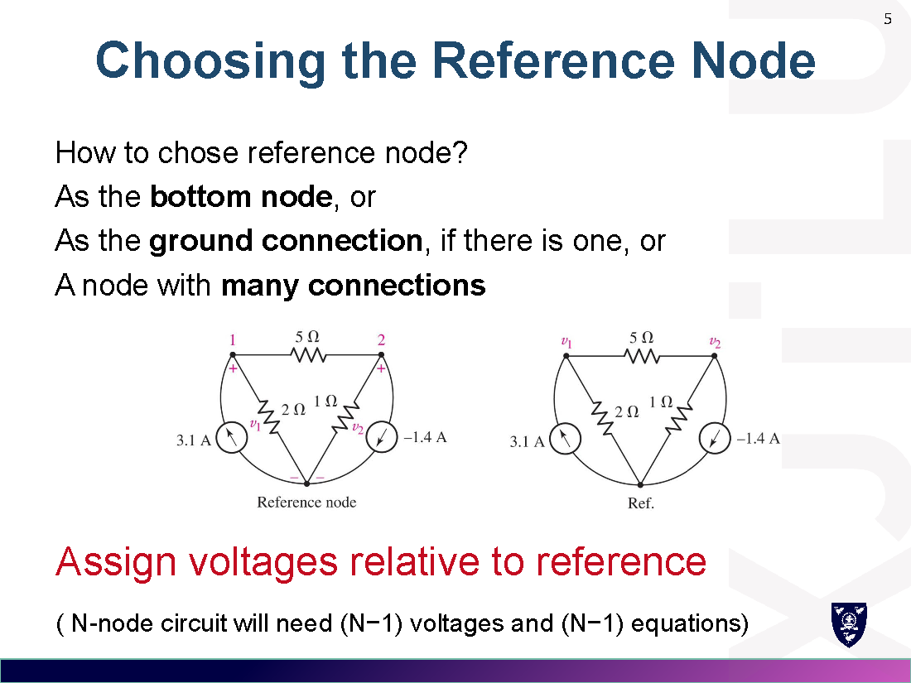
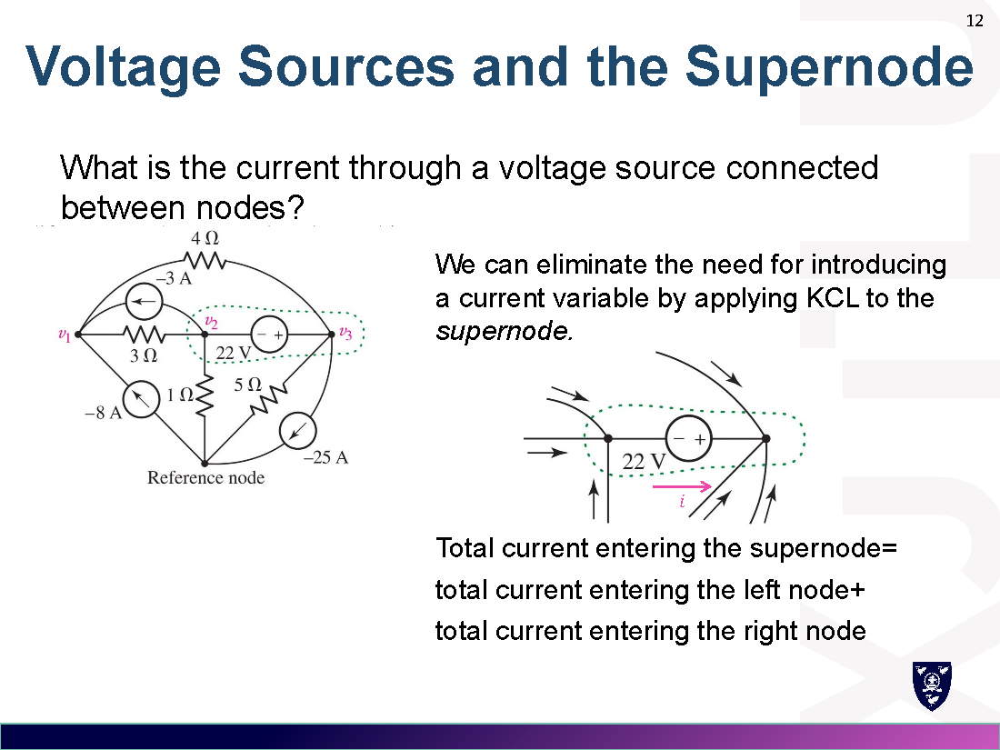
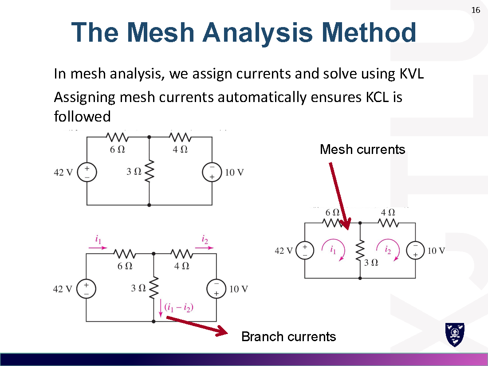
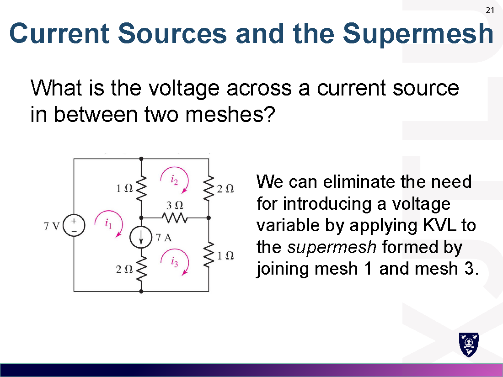
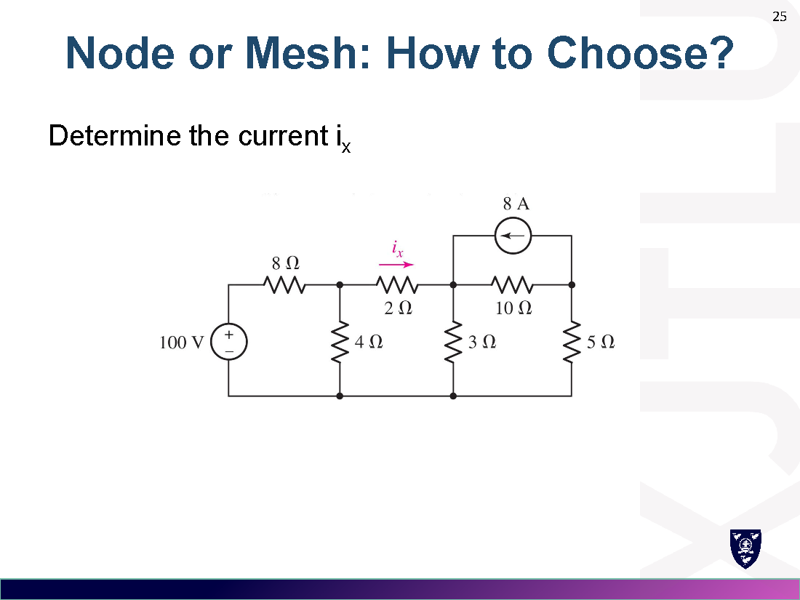

# Week 3 · 节点与网孔分析
# Basic Nodal and Mesh Analysis

> 对应讲义：`Lecture/Week3-Basic Nodal and Mesh Analysis_preview.pdf`

---

## 0. 引言 / Introduction

电路变复杂后，需要**系统化**地应用 KCL、KVL、欧姆定律：

- **节点分析 Nodal analysis**：给每个节点赋电压，然后列 **KCL**。
- **网孔分析 Mesh analysis**：给每个网孔赋电流，然后列 **KVL**。

> 解题总思路：先作**假设**（设电压极性、电流方向）→ 再基于假设列方程分析。

---

## 1. 节点分析法 / Nodal Analysis

### 1.1 基本步骤 Basic Steps

1. 选**参考节点**（reference node，接地/最底部/连接最多的节点），令其电压为 0。
2. 给其余节点赋节点电压 $v_1, v_2, \dots$。
3. 对每个非参考节点列 **KCL**（流出电流之和 = 0 或 流入 = 流出）。
4. 用欧姆定律把支路电流写成节点电压：$i=\dfrac{v_a-v_b}{R}$。
5. 解方程组得到各节点电压。

> N 个节点的电路需要 $(N-1)$ 个电压变量和 $(N-1)$ 个方程。

### 1.2 选择参考节点 Choosing the Reference Node

优先选：底部节点 / 接地端 / **连接支路最多的节点**。

### 1.3 列方程 Example

对 node 1（$\sum$ 流出 = 0）：$\dfrac{v_1}{2}+\dfrac{v_1-v_2}{5}-3.1=0$
对 node 2：$\dfrac{v_2}{1}+\dfrac{v_2-v_1}{5}-1.4=0$
解得 $v_1=5\,\mathrm{V},\ v_2=2\,\mathrm{V}$。

### 1.4 矩阵法 Matrix Method

把方程组写成 $A\boldsymbol{v}=B$ 形式，用计算器求 $\boldsymbol{v}=A^{-1}B$：

$$\begin{bmatrix}5 & -2 \\ -1 & 4\end{bmatrix}\begin{bmatrix}v_1 \\ v_2\end{bmatrix}=\begin{bmatrix}60 \\ 60\end{bmatrix} \Rightarrow v_1=v_2=20\,\mathrm{V}$$

### 1.5 含受控源 Dependent Source

- 受控源先按普通源列方程。
- **关键步骤**：用节点电压（或网孔电流）**消去受控量**——把控制量（如 $i_1$）用节点电压表出，未知数才能等于方程数。

#### 典型例题：求受控源提供的功率
*Typical example: find the power supplied by the dependent source.*

**电路**（节点 0 为参考地）：节点 1 与 0 之间接 $2\,\Omega$ 电阻；节点 1 与 2 之间接 $1\,\Omega$ 电阻；节点 2 与 0 之间接 $3\,\Omega$ 电阻；$15\,\mathrm{A}$ 独立电流源从 0 流入节点 1；受控电流源 $3i_1$ 从 0 流入节点 2，其中 $i_1$ 是流过 $2\,\Omega$ 电阻、方向由节点 1 指向 0 的电流。

**Step 1 · 列 KCL**（流出 = 流入）：

$$\text{node 1:}\quad \frac{v_1}{2}+\frac{v_1-v_2}{1}=15$$

$$\text{node 2:}\quad \frac{v_2}{3}+\frac{v_2-v_1}{1}=3i_1$$

**Step 2 · 消去受控量（关键步骤）**：由欧姆定律，$2\,\Omega$ 电阻电流 $i_1=\dfrac{v_1}{2}$，即 $v_1=2i_1$。代入并化简：

$$\begin{cases}3v_1-2v_2=30\\ -15v_1+8v_2=0\end{cases}\quad\Longrightarrow\quad v_1=-40\,\mathrm{V},\quad v_2=-75\,\mathrm{V}$$

于是 $i_1=\dfrac{v_1}{2}=-20\,\mathrm{A}$。

**Step 3 · 求受控源功率**：受控源两端电压为 $v_2$、电流为 $3i_1$，其**吸收**功率为

$$p=-(3i_1)\,v_2=-\big[3\times(-20)\big]\times(-75)=-4500\,\mathrm{W}=-4.5\,\mathrm{kW}$$

> $p<0$，说明受控源**吸收 $-4.5\,\mathrm{kW}$**，即实际**对外提供（supply）$4.5\,\mathrm{kW}$** 功率。
> 直观理解：$v_2=-75\,\mathrm{V}$，实际电流从节点 2（低电位）流向参考地（高电位）——从低电位向高电位搬运电荷，正是电源「供电」的表现。

**小结**：含受控源时，多出的未知量（受控量）必须用节点电压表出；功率按被动符号约定判定，$p<0$ 为提供功率。

---

## 2. 超节点 / The Supernode

**问题**：两非参考节点之间直接连一个**电压源**，其电流未知。

**解法**：把电压源两端节点及其间的电压源看成一个"**超节点**"（supernode），对超节点整体列 KCL；再补上电压源两端电压约束方程。

- 对超节点列 KCL（进入超节点的电流之和 = 流出之和）。
- 补充：$v_2 - v_1 =$ 电压源电压。

> 例：超节点方程 + 电压源约束 $v_1-v_2$（或 $v_2-v_1$）后，未知数 = 方程数。

---

## 3. 网孔分析法 / Mesh Analysis

### 3.1 网孔的定义 Mesh

**网孔 mesh**：内部不含其它回路的回路（a loop which does not contain any other loops within it）。

### 3.2 基本步骤 Basic Steps

1. 给每个网孔赋**网孔电流**（mesh current，通常取顺时针）。
2. 对每个网孔列 **KVL**（$\sum$ 电压降 = 0）。
3. 支路电流 = 相邻网孔电流的代数和（公共支路 $i=i_1-i_2$）。
4. 解方程得网孔电流。

> 网孔电流自动满足 KCL。

> 例：mesh 1：$-42+6i_1+3(i_1-i_2)=0$；mesh 2：$3(i_2-i_1)+4i_2-10=0$。

### 3.3 三网孔示例 Three-Mesh Example

$$\begin{cases}3i_1-i_2-2i_3=1\\ -i_1+6i_2-3i_3=0\\ -2i_1-3i_2+6i_3=6\end{cases}\Rightarrow i_1=3\,\mathrm{A},\,i_2=2\,\mathrm{A},\,i_3=3\,\mathrm{A}$$

### 3.4 含受控源 Dependent Source

与节点法类似：先按普通源列 KVL，再用网孔电流**消去受控量**。

---

## 4. 超网孔 / The Supermesh

**问题**：两网孔之间夹一个**电流源**（公共支路是电流源），其两端电压未知。

**解法**：把电流源两侧的网孔合并成"**超网孔**"（supermesh），沿超网孔外围列 KVL（避开电流源两端未知电压）；再补上电流源约束方程 $i_a-i_b=i_s$。

> 例：KVL 绕 mesh 2 + KVL 绕 supermesh 1/3 + 电流源约束 $7=i_1-i_3$。

---

## 5. 节点法 vs 网孔法 / Nodal vs Mesh: How to Choose?

选择原则：
1. **方程数少**的方法（fewer equations）。
2. 电流源多 → 用**节点法**（电流源适合 KCL）；电压源多 → 用**网孔法**。
3. 也可两种方法都算，互相验证。

> 同一个电路两种方法结果一致（例：$i_x=2.79\,\mathrm{A}$）。

---

## 6. 易错点 / Common Mistakes

1. **参考节点**只选一个，其余节点电压都是相对它。
2. 超节点/超网孔必须**补约束方程**（电压源两端电压关系 / 电流源电流关系）。
3. 公共支路电流是两网孔电流**之差**（方向要看清）。
4. 含受控源：必须用节点电压/网孔电流把受控量**消去**，否则未知数多于方程。
5. 列 KCL/KVL 前先把电流、电压的参考方向**标清楚**。

---

## 7. 公式速查 / Formula Summary

| 方法 | 变量 | 依据 | 特例 |
|---|---|---|---|
| 节点法 Nodal | 节点电压 $v$ | KCL | 电压源→超节点 Supernode |
| 网孔法 Mesh | 网孔电流 $i$ | KVL | 电流源→超网孔 Supermesh |

$$\text{节点法: } \sum i_{out}=0,\quad i_{branch}=\frac{v_a-v_b}{R}$$
$$\text{网孔法: } \sum v_{drops}=0,\quad i_{shared}=i_1-i_2$$
$$\text{矩阵法: } A\boldsymbol{v}=B \Rightarrow \boldsymbol{v}=A^{-1}B$$
