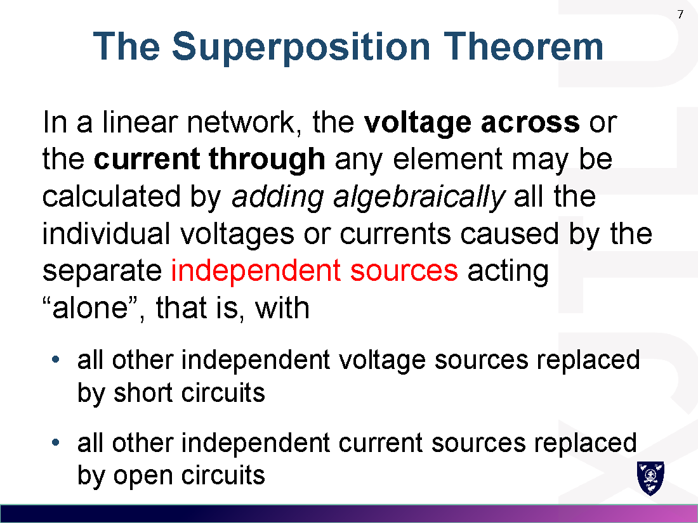
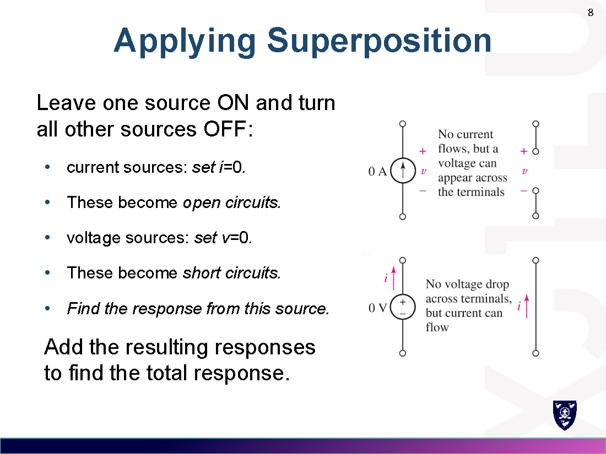
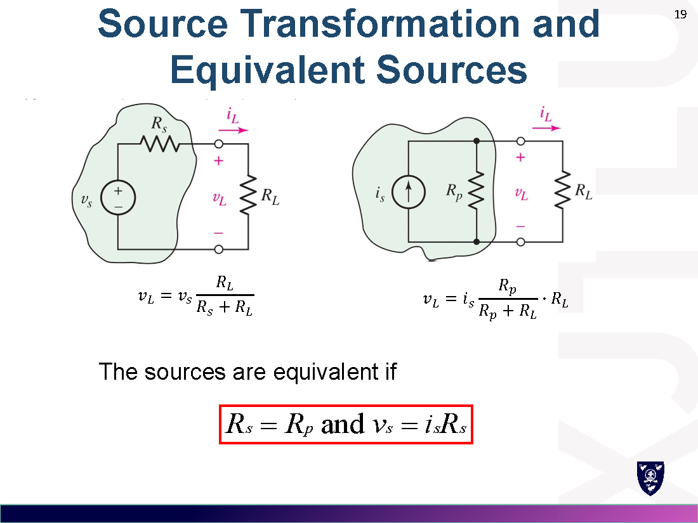
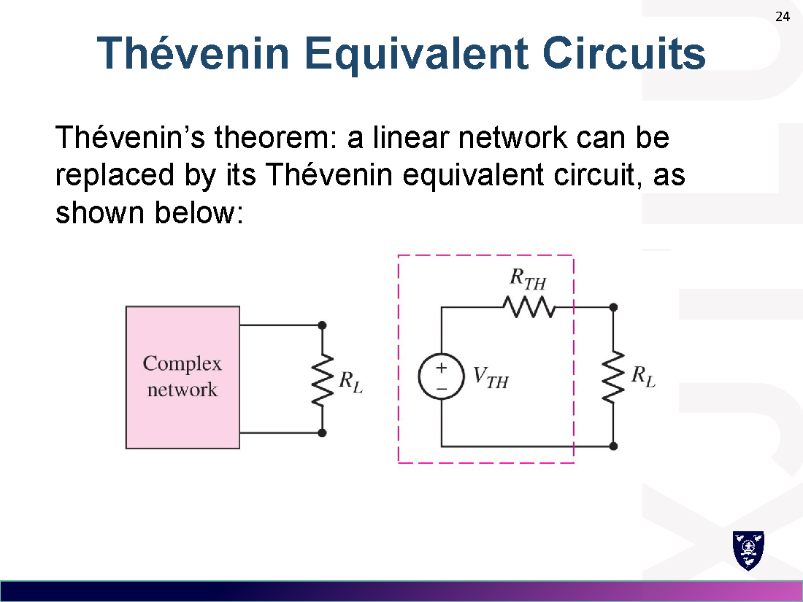
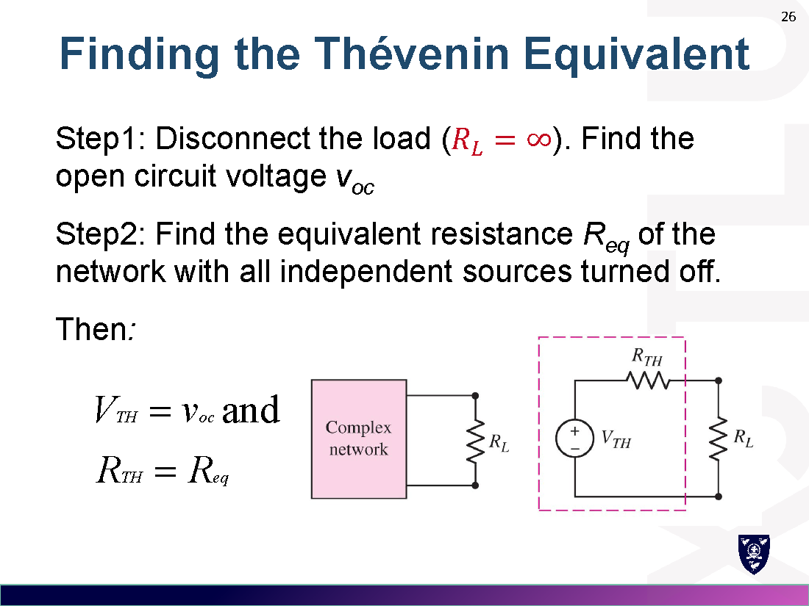
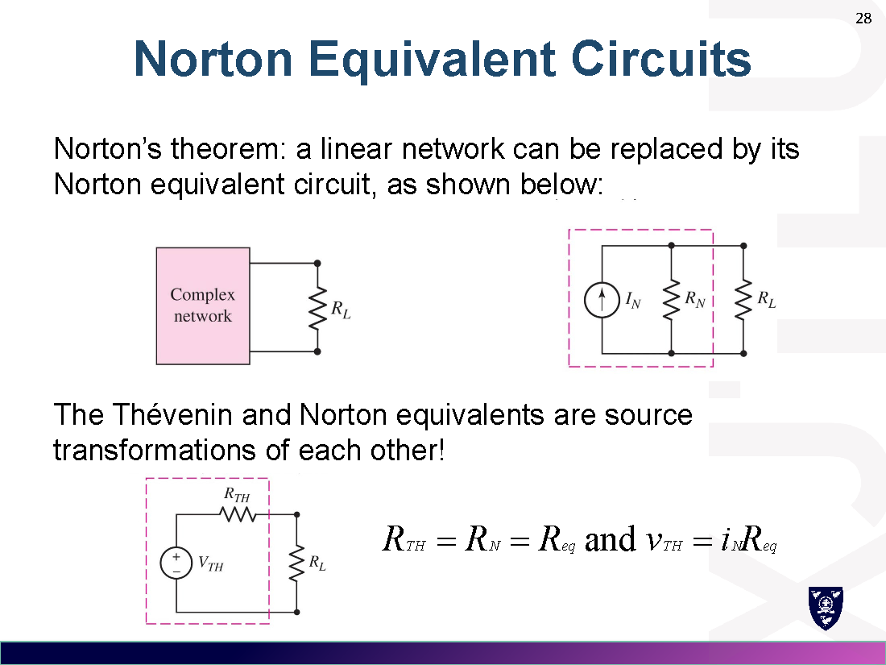
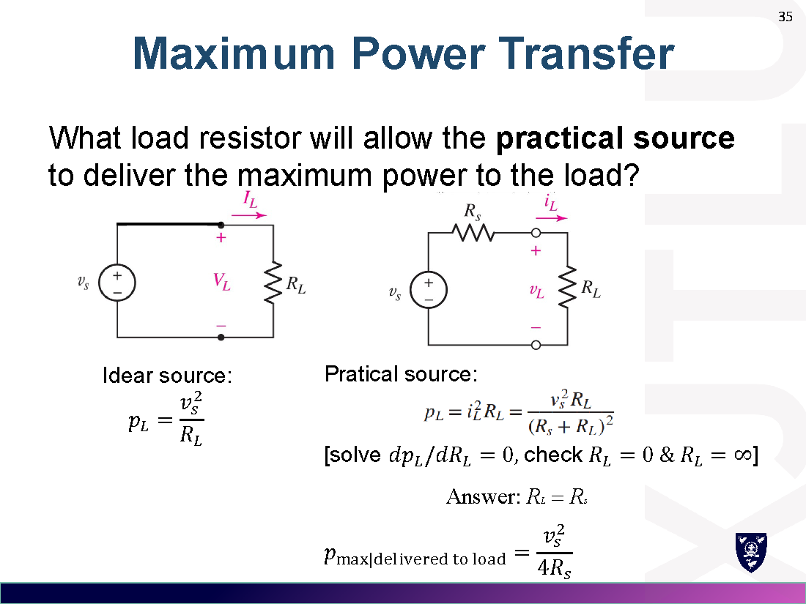
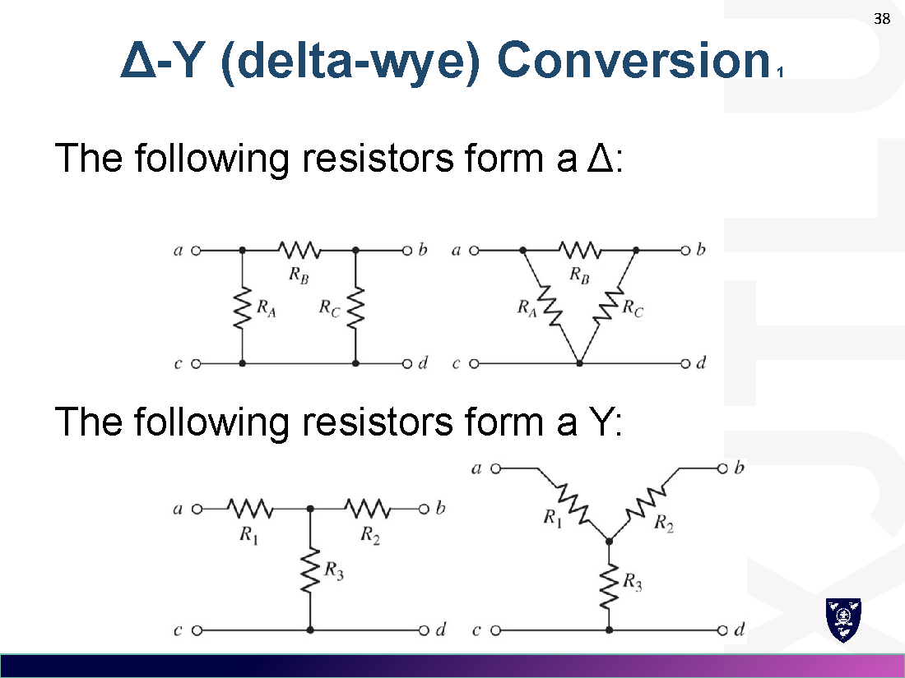
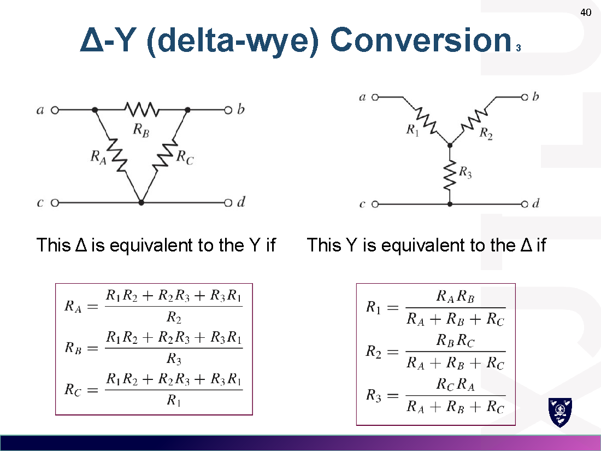

# Week 4 · 常用电路分析技巧
# Handy Circuit Analysis Techniques

> 对应讲义：`Lecture/Week4-Handy Circuit Analysis Techniques_preview.pdf`

---

## 1. 线性与叠加 / Linearity and Superposition

### 1.1 线性元件与线性电路 Linear Elements & Circuits

- **线性元件**：v-i 关系为线性（如电阻 $v(t)=Ri(t)$）。
  - 若 $i$ 产生 $v$，则 $Ki$ 产生 $Kv$（齐次性 homogeneity）。
  - 若 $i_1\to v_1,\ i_2\to v_2$，则 $i_1+i_2\to v_1+v_2$（可加性 additivity）。
- **线性受控源**：输出与某电压/电流的**一次幂**成正比。
- **线性电路**：只含独立源、线性受控源、线性元件。

### 1.2 叠加定理 Superposition Theorem（叠加定理）

在**线性网络**中，任一元件的电压/电流 = 各**独立源单独作用**时产生的响应的**代数和**。

**关断（turn off）其它源的方式：**
- 独立**电压源** → 短路（$v=0$，short circuit）
- 独立**电流源** → 开路（$i=0$，open circuit）
- **受控源永远不关断**（dependent sources are never turned off）！

> 例 Example：求 $i_x$。
> 电流源关断：$i_x'=\dfrac{3}{6+9}=0.2\,\mathrm{A}$；电压源关断：$i_x''=\dfrac{6}{6+9}\times2=0.8\,\mathrm{A}$。
> $i_x=i_x'+i_x''=0.2+0.8=1.0\,\mathrm{A}$。

> ⚠️ 注意：**功率不能直接叠加**（$p\propto i^2$ 非线性），需先叠加电流/电压再算功率。

---

## 2. 电源等效变换 / Source Transformations

### 2.1 实际电压源与电流源 Practical Sources

- 实际电压源：理想源 $v_s$ + 串联内阻 $R_s$，$v_L=v_s-R_s i_L$。
- 实际电流源：理想源 $i_s$ + 并联内阻 $R_p$，$i_L=i_s-\dfrac{v_L}{R_p}$。

### 2.2 等效变换 Source Transformation

两个实际电源在**负载端子处**等效：

$$R_s=R_p,\qquad v_s=i_s R_s$$

- 电流源箭头指向 = 电压源 **+ 端**。
- 注意：**只对负载等效，内部不等效**（internal power 不同）。

> 例 Example：5 kΩ 并联 9 mA 电流源 → 等效为 5 kΩ 串联 $45\,\mathrm{V}$ 电压源；$I=\dfrac{45-3}{5+4.7+3}=3.307\,\mathrm{mA}$。

---

## 3. 戴维南定理 / Thévenin Equivalent Circuits

线性网络可替换为：**电压源 $V_{TH}$ 串联电阻 $R_{TH}$**。

### 3.1 求戴维南等效 Finding the Thévenin Equivalent

**Step 1**：断开负载（$R_L=\infty$），求**开路电压** $v_{oc}$。
**Step 2**：所有独立源**关断**后求端口等效电阻 $R_{eq}$。
$$V_{TH}=v_{oc},\qquad R_{TH}=R_{eq}$$

> 例：$V_{TH}=12\times\dfrac{6}{3+6}=8\,\mathrm{V}$，$R_{TH}=3\parallel6+7=9\,\Omega$。

---

## 4. 诺顿定理 / Norton Equivalent Circuits

线性网络可替换为：**电流源 $I_N$ 并联电阻 $R_N$**。

### 4.1 求诺顿等效 Finding the Norton Equivalent

**Step 1**：负载短路（$R_L=0$），求**短路电流** $i_{sc}$。
**Step 2**：独立源关断求 $R_{eq}$。
$$I_N=i_{sc},\qquad R_N=R_{eq}$$

**戴维南与诺顿互为电源变换**：
$$R_{TH}=R_N=R_{eq},\qquad V_{TH}=I_N R_N$$

---

## 5. 含受控源的等效 / Thévenin with Dependent Sources

受控源**不能直接关断**，常用两种方法：

**方法一**：分别求 $V_{TH}=v_{oc}$ 和 $I_N=i_{sc}$，则 $R_{TH}=\dfrac{V_{TH}}{I_N}$。

**方法二（测试源法）**：独立源全关断后，在端口加**测试源**（$v_{test}$ 或 $i_{test}$），求 $R_{TH}=\dfrac{v_{test}}{i_{test}}$。

> ⚠️ 当 $V_{TH}$ 与 $I_N$ **都为零**时，方法一失效，必须用测试源法（例：$R_{TH}=0.6\,\Omega$）。

---

## 6. 最大功率传输 / Maximum Power Transfer

**最大功率传输定理**：当负载电阻等于电源内阻（或网络的戴维南电阻）时，负载获得最大功率：

$$R_L=R_s\ (=R_{TH})$$

$$p_{max}=\frac{v_s^2}{4R_s}=\frac{V_{TH}^2}{4R_{TH}}$$

> 推导：$p_L=\dfrac{v_s^2 R_L}{(R_s+R_L)^2}$，令 $\dfrac{dp_L}{dR_L}=0$ 得 $R_L=R_s$。

---

## 7. Δ-Y 变换 / Delta-Wye (Δ-Y) Conversion

当电阻既非串联也非并联时，用 Δ-Y 变换。

### 7.1 Δ → Y（三角形 → 星形）

设 Δ 三边电阻为 $R_a,\ R_b,\ R_c$，星形三臂为 $R_1,\ R_2,\ R_3$（对应顶点）：

$$R_1=\frac{R_a R_c}{R_a+R_b+R_c},\quad R_2=\frac{R_a R_b}{R_a+R_b+R_c},\quad R_3=\frac{R_b R_c}{R_a+R_b+R_c}$$

> 口诀：某臂 = **相邻两边乘积 / 三边之和**。

### 7.2 Y → Δ（星形 → 三角形）

$$R_a=\frac{R_1R_2+R_2R_3+R_3R_1}{R_3},\quad R_b=\frac{R_1R_2+R_2R_3+R_3R_1}{R_1},\quad R_c=\frac{R_1R_2+R_2R_3+R_3R_1}{R_2}$$

> 口诀：某边 = **两两乘积之和 / 对面那个臂**。

---

## 8. 易错点 / Common Mistakes

1. **叠加时受控源不关断**（最常考陷阱）。
2. 叠加只能叠加**电流/电压**，不能叠加功率。
3. 戴维南 $R_{TH}$ 求法：独立源要**全部关断**；受控源保留。
4. 电源变换只对**负载等效**，源内部功率不相等。
5. 分流/分压公式分子方向（Week 2 已强调）。
6. Δ-Y 变换后要核对：星形总电阻 = 相邻乘积和/三边和。

---

## 9. 公式速查 / Formula Summary

$$\text{叠加: } x=\sum_k x_k \quad(V\to \text{短路},\ I\to \text{开路},\ \text{受控源保留})$$
$$\text{电源变换: } R_s=R_p,\quad v_s=i_sR_s$$
$$\text{戴维南: } V_{TH}=v_{oc},\ R_{TH}=R_{eq} \qquad \text{诺顿: } I_N=i_{sc},\ R_N=R_{eq}$$
$$V_{TH}=I_NR_N,\qquad \text{含受控源: } R_{TH}=\frac{V_{TH}}{I_N}\ \text{或}\ \frac{v_{test}}{i_{test}}$$
$$\text{最大功率: } R_L=R_{TH},\quad p_{max}=\frac{V_{TH}^2}{4R_{TH}}$$
$$\Delta\to Y:\ R_1=\frac{R_aR_c}{\Sigma},\quad Y\to\Delta:\ R_a=\frac{R_1R_2+R_2R_3+R_3R_1}{R_3}$$
