# Week 5 · 运算放大器
# The Operational Amplifier

> 对应讲义：`Lecture/Week 5_Operational Amplifier.pdf`（Part 2 开始）

---

## 1. 运放简介 / Introduction

- **运算放大器**（op amp）是一种集成电路，**放大两输入电压之差**，产生单端输出。
- 名称来源：最初用于模拟计算机中的**加法、减法、乘法、除法、微分、积分**等数学运算。
- 三个主要端子：**反相输入 $-$（inverting，$v_1$）、同相输入 $+$（non-inverting，$v_2$）、输出**（output）。

$$v_{out}=A\,v_d=A(v_2-v_1)$$

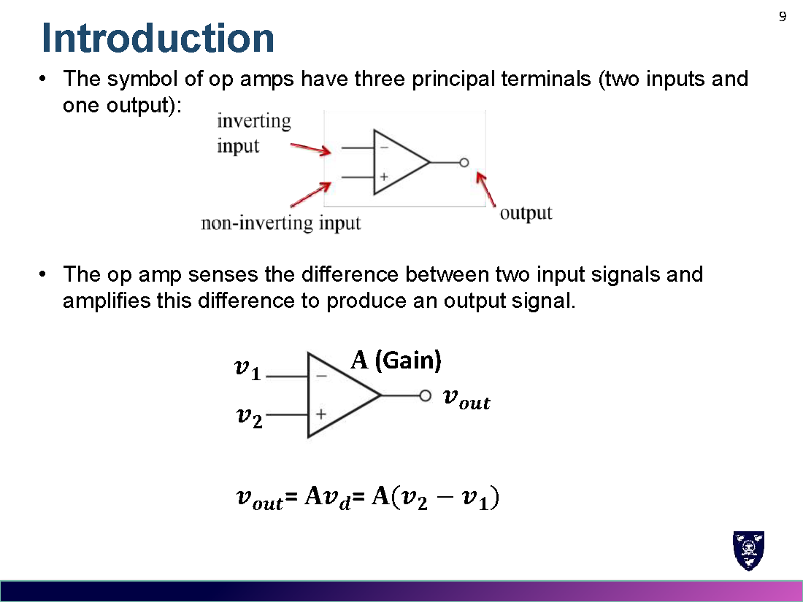

---

## 2. 供电与饱和 / Power Supply & Saturation

- 运放需要正负对称电源（典型 $\pm5\sim\pm24\,\mathrm{V}$）。
- 输出是**线性响应**，但被**正/负饱和区**所限制：

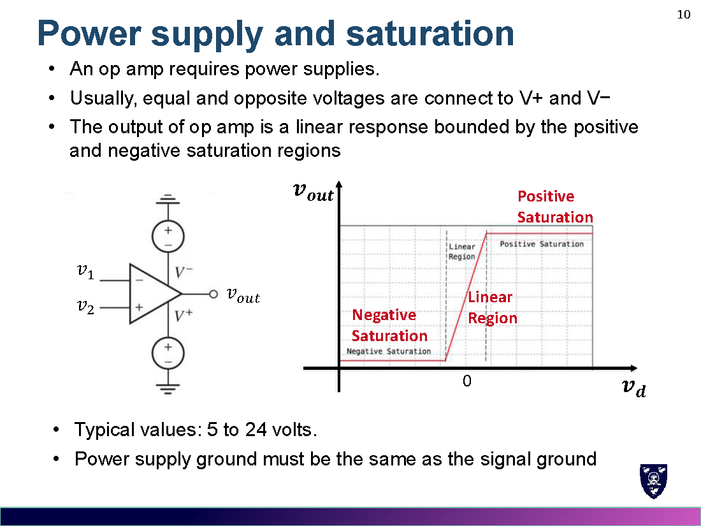

- 当 $|v_d|$ 很小，输出在线性区；$v_d$ 稍大即进入饱和（输出 ≈ $V^+$ 或 $V^-$）。
- 电源地与信号地必须**共地**。

---

## 3. 反馈 Feedback（反馈）

- **负反馈 Negative feedback**：输出回接到反相输入端 → 稳定（可把巨大而不可预测的开环增益变为稳定可控的增益）。
- **正反馈 Positive feedback**：输出回接到同相输入端 → 不稳定/饱和。

> 负反馈：$v_{out}=\dfrac{A}{A+1}v_{in}\approx v_{in}$（A 很大时稳定）。
> 正反馈：$v_{out}=\dfrac{A}{A-1}v_{in}$（发散到饱和）。

---

## 4. 理想运放两条规则 / Two Ideal Op Amp Rules

**理想运放**：$A=\infty,\ R_i=\infty,\ R_o=0$，由此得到两条规则：

1. **Rule 1**：输入端子**没有电流流入**（$i_{in}=0$）。
2. **Rule 2**：两输入端之间**无电压差**（$v_d=0$，即 $v_+=v_-$）。

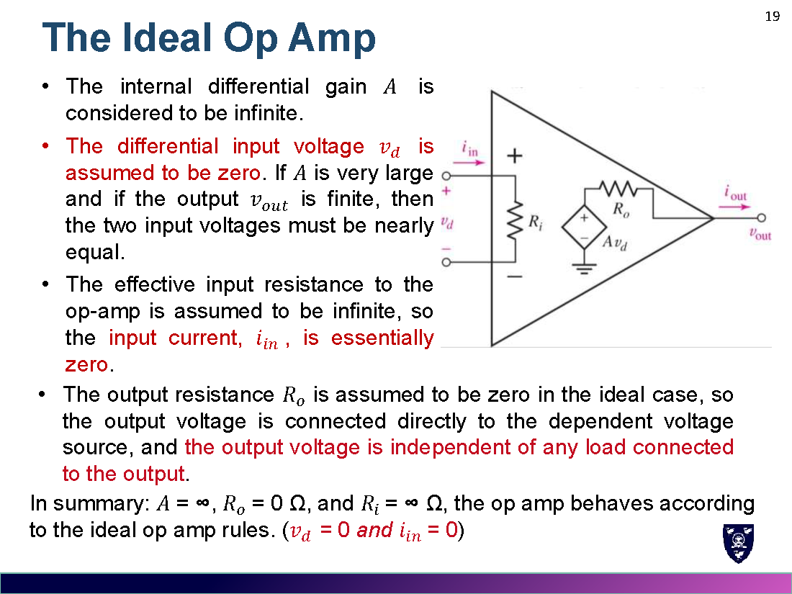

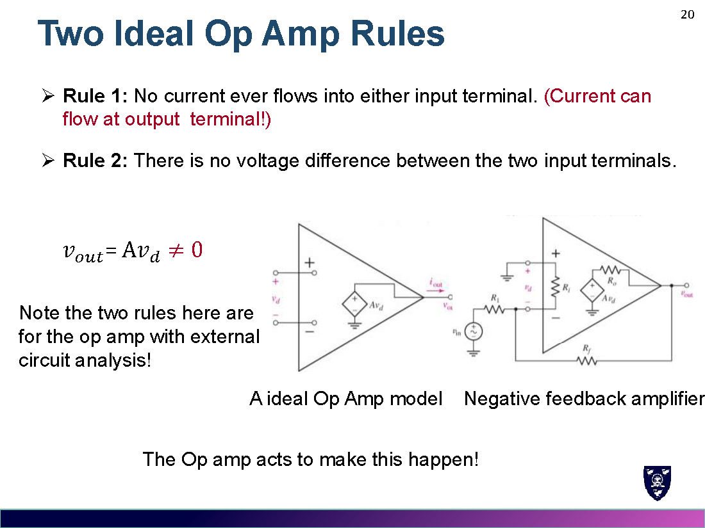

> 这两条规则用于**含运放的外部电路分析**；运放自身会"设法"使 $v_d=0$ 成立。

---

## 5. 反相放大器 / The Inverting Amplifier

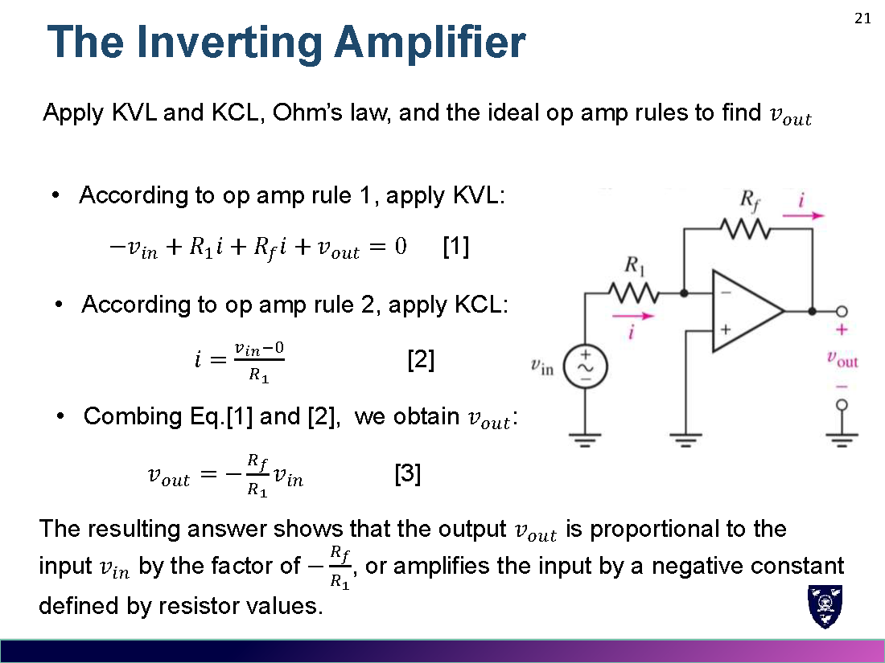

由 Rule 1、Rule 2 + KCL/KVL：

$$v_{out}=-\frac{R_f}{R_1}\,v_{in}$$

> 例 Example：$v_{in}=5\sin3t\,\mathrm{mV},\ R_f=47\,\mathrm{k\Omega},\ R_1=4.7\,\mathrm{k\Omega}$ → $v_{out}=-50\sin3t\,\mathrm{mV}$（放大 10 倍并反相）。

---

## 6. 同相放大器 / The Non-inverting Amplifier

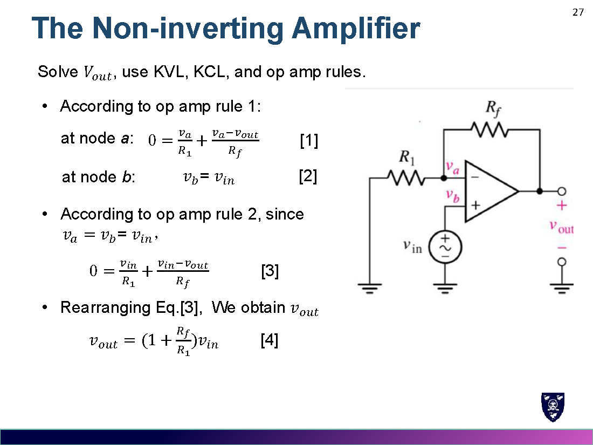

$$v_{out}=\left(1+\frac{R_f}{R_1}\right)v_{in}$$

> 例：同样参数 → $v_{out}=55\sin3t\,\mathrm{mV}$（放大 11 倍，同相）。

---

## 7. 电压跟随器 / The Voltage Follower（缓冲器 Buffer）

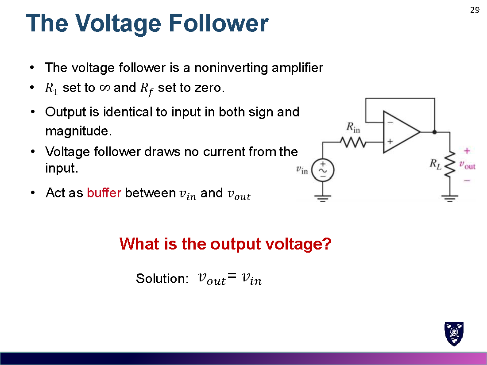

同相放大器的特例：$R_1=\infty,\ R_f=0$：

$$v_{out}=v_{in}$$

- 输出与输入**同号同幅**；不从输入吸取电流；起**缓冲（隔离）**作用。

---

## 8. 加法器 / The Summing Amplifier

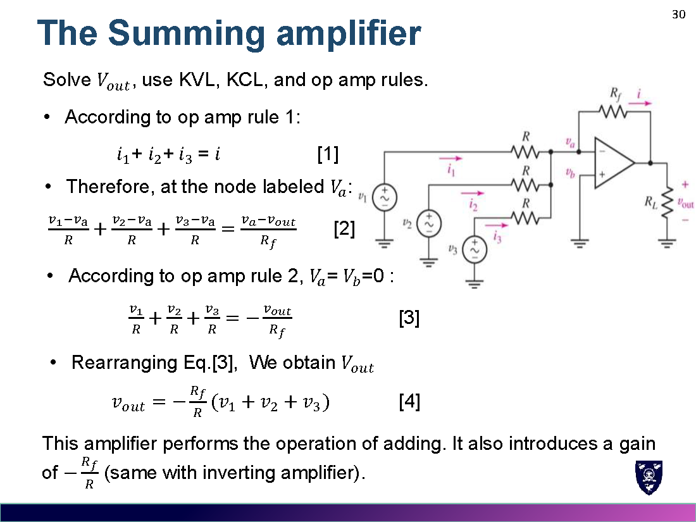

$$v_{out}=-\frac{R_f}{R}(v_1+v_2+v_3)$$

- 实现"相加"运算，并附带增益 $-\dfrac{R_f}{R}$（与反相放大器一致）。

### 8.1 基本运放电路汇总 Summary

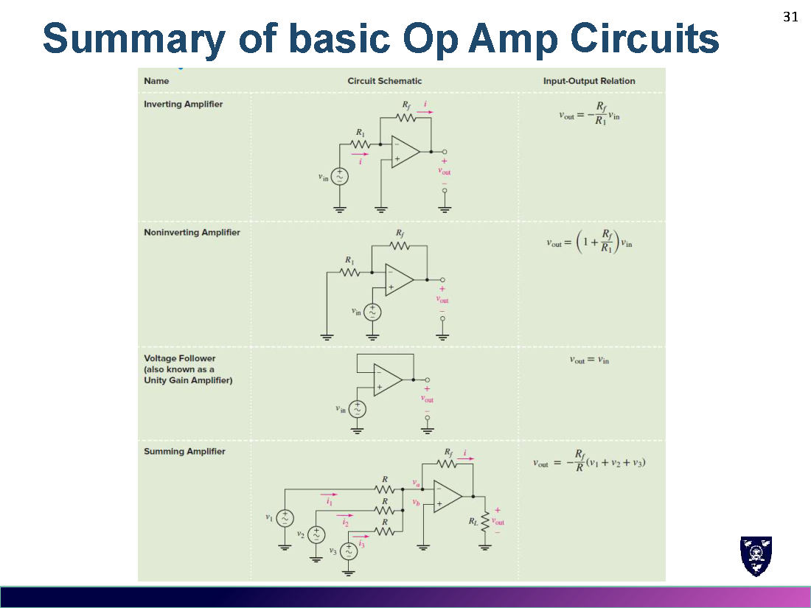

| 电路 Circuit | 输出 $v_{out}$ |
|---|---|
| 反相 Inverting | $-\dfrac{R_f}{R_1}v_{in}$ |
| 同相 Non-inverting | $\left(1+\dfrac{R_f}{R_1}\right)v_{in}$ |
| 电压跟随器 Follower | $v_{in}$ |
| 加法器 Summing | $-\dfrac{R_f}{R}(v_1+v_2+v_3)$ |

---

## 9. 级联 / Cascaded Stages

- 多个运放级联，**逐级分析**（前一级输出 = 后一级输入）。
- 级联可组合出所需输入-输出关系（例：求和 + 反相 → 不反相的求和）。

---

## 10. 比较器 Comparator（比较器）

- 运放**开环**（open loop）使用：开环增益极大，微小 $v_d$ 就使输出**饱和**。
- 输出取决于输入与**参考电压**的比较。

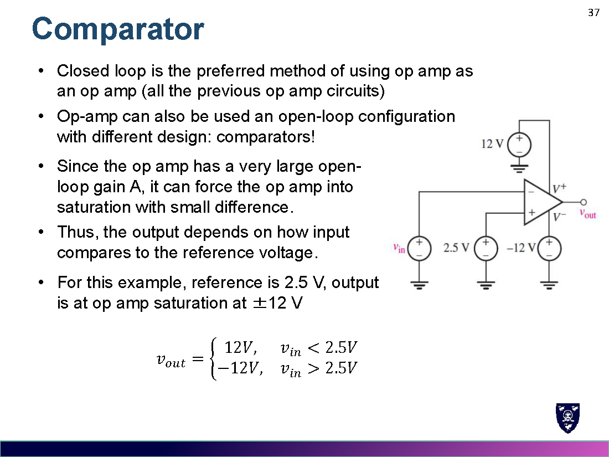

> 例：参考 2.5 V，饱和 $\pm12\,\mathrm{V}$：
> $$v_{out}=\begin{cases}12\,\mathrm{V}, & v_{in}<2.5\,\mathrm{V}\\ -12\,\mathrm{V}, & v_{in}>2.5\,\mathrm{V}\end{cases}$$

---

## 11. 施密特触发器 / Schmitt Trigger

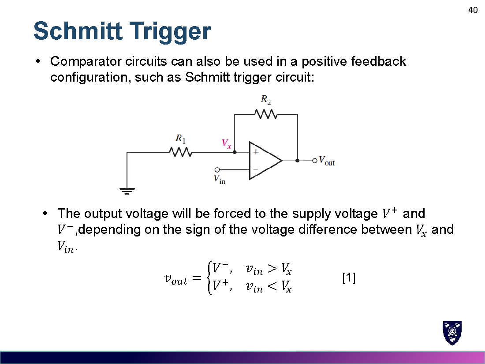

- 比较器 + **正反馈** → 具有**迟滞（hysteresis）**和"记忆"。
- 有两个阈值（上阈值 $V_T^{upper}$、下阈值 $V_T^{lower}$），抗输入波动干扰：

$$V_T^{upper}=\frac{R_1}{R_1+R_2}\,V^+,\qquad V_T^{lower}=\frac{R_1}{R_1+R_2}\,V^-$$

- 输出状态切换逻辑：
$$v_{out}=\begin{cases}V^-, & v_{in}>V_x\\ V^+, & v_{in}<V_x\end{cases},\qquad V_x=\frac{R_1}{R_1+R_2}v_{out}$$

---

## 12. 易错点 / Common Mistakes

1. 两条理想规则只对**负反馈/线性区**运放电路适用；比较器（开环）输出饱和，$v_d\neq0$。
2. 反相与同相增益别记混：反相 $-\dfrac{R_f}{R_1}$，同相 $1+\dfrac{R_f}{R_1}$。
3. 加法器输出带**负号**（反相）。
4. $v_+=v_-$ 的"虚短"（virtual short），但两输入端**无电流**（虚断 virtual open）。
5. 施密特触发器有**两个**阈值（迟滞窗口），不是单一阈值。

---

## 13. 公式速查 / Formula Summary

$$v_{out}=A(v_2-v_1),\qquad \text{理想: } A=\infty,\ R_i=\infty,\ R_o=0\ \Rightarrow\ v_d=0,\ i_{in}=0$$
$$\text{反相: } v_{out}=-\frac{R_f}{R_1}v_{in}\qquad \text{同相: } v_{out}=\left(1+\frac{R_f}{R_1}\right)v_{in}$$
$$\text{加法器: } v_{out}=-\frac{R_f}{R}\sum v_k\qquad \text{跟随器: } v_{out}=v_{in}$$
$$\text{施密特阈值: } V_T=\frac{R_1}{R_1+R_2}v_{out}$$
