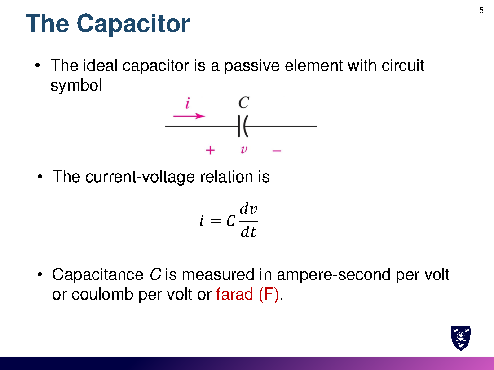
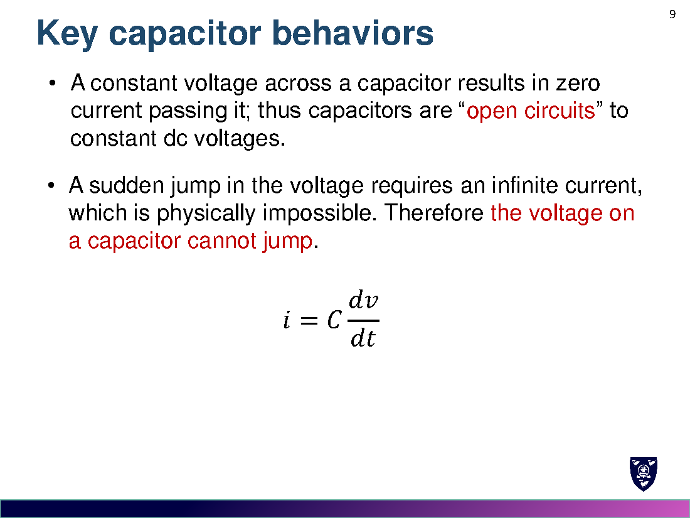
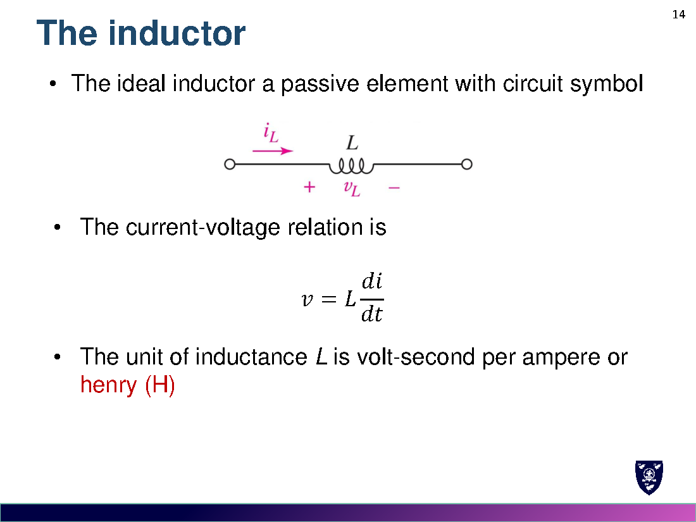
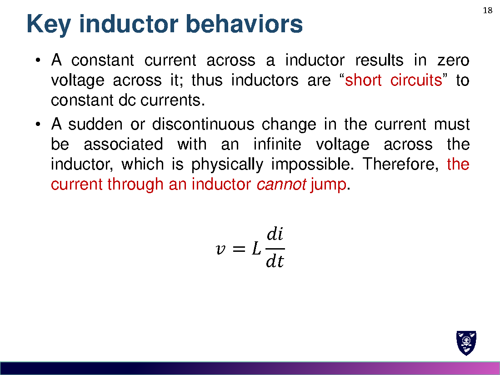
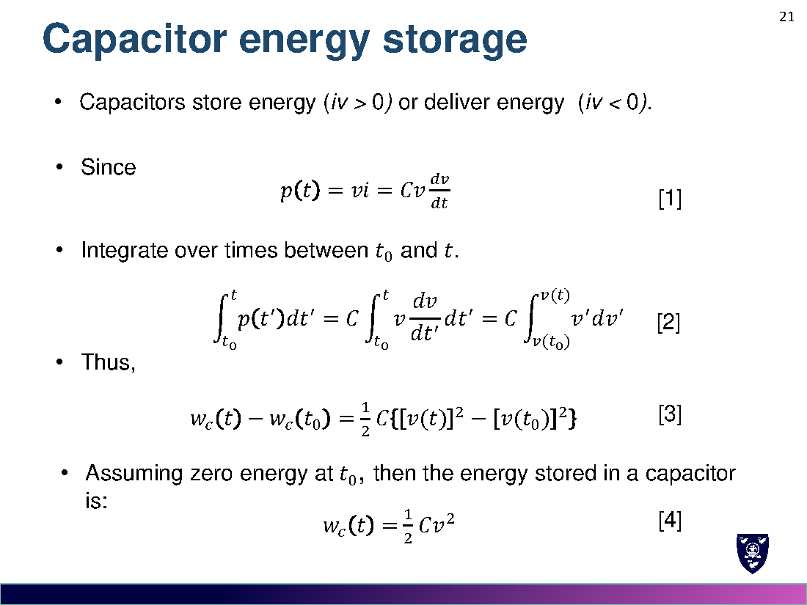
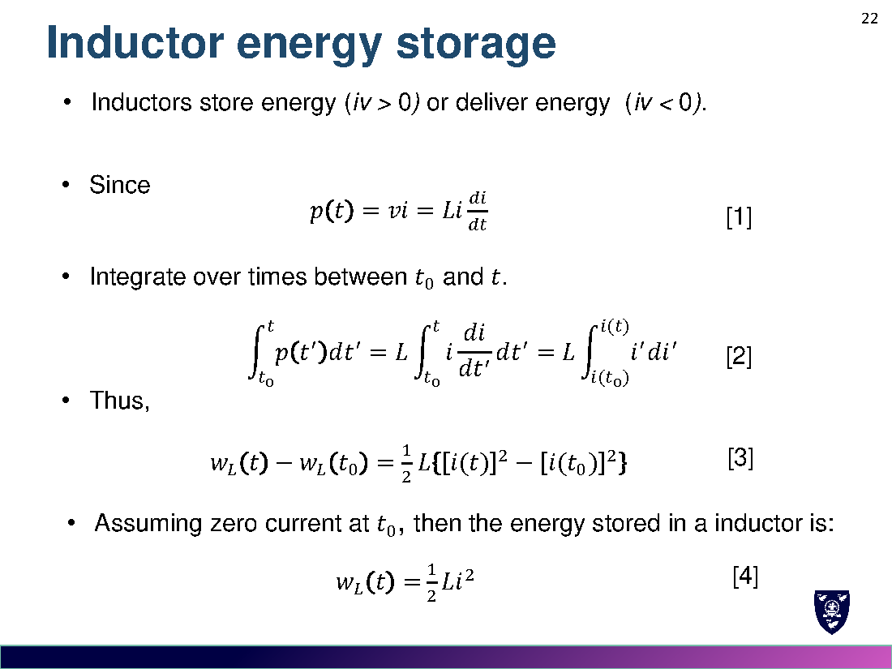
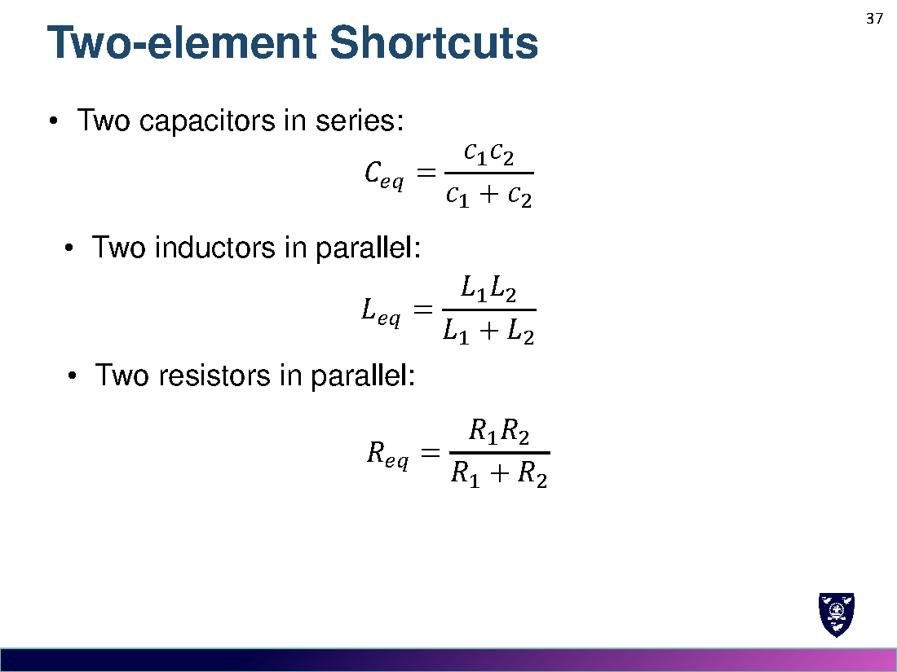
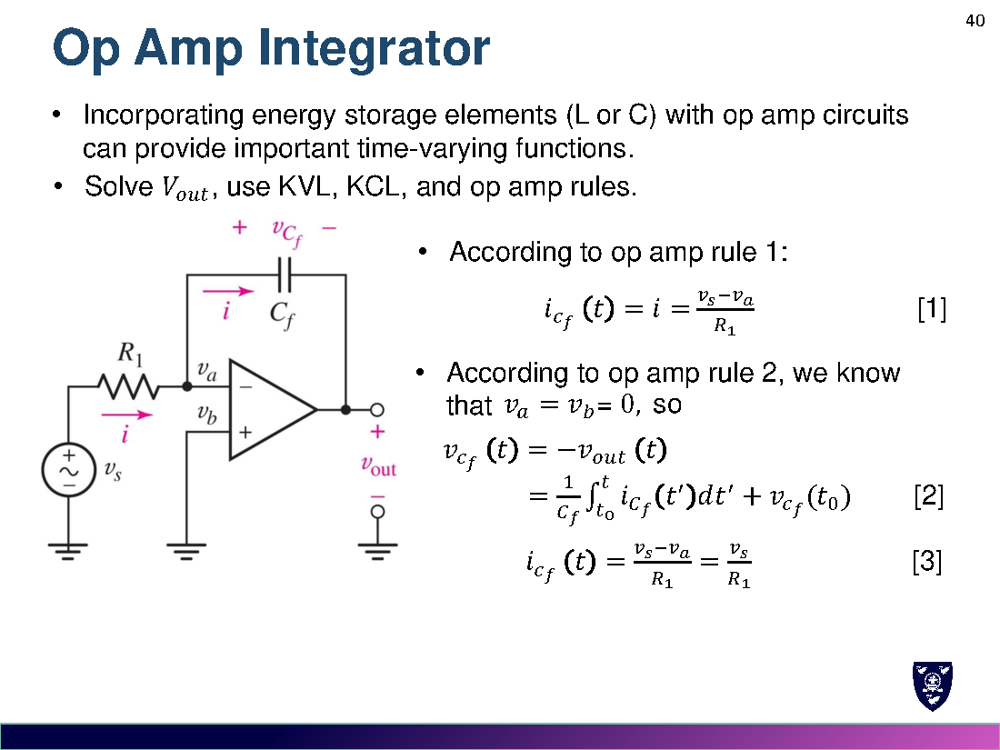
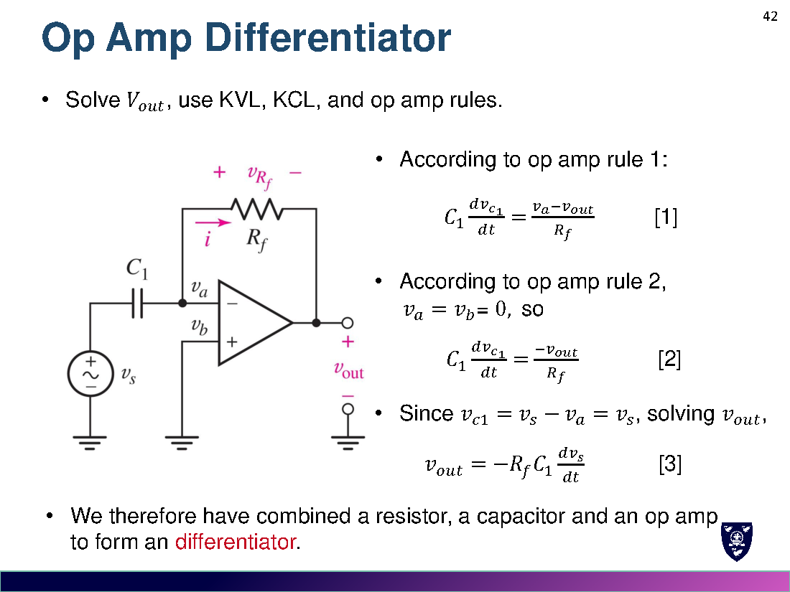

# Week 6 · 电容与电感
# Capacitors and Inductors

> 对应讲义：`Lecture/Week 6_Capacitos and inductors.pdf`

---

## 0. 有源与无源元件 / Active & Passive Elements

- **有源元件 Active**：能在无限时间内对外提供平均功率大于零（理想源、运放、晶体管）。
- **无源元件 Passive**：不能对外提供平均功率大于零（电阻、电容、电感）。

---

## 1. 电容 / The Capacitor

### 1.1 定义与 v-i 关系

$$i=C\frac{dv}{dt},\qquad q=Cv$$

- $C$：电容 capacitance，单位法拉 farad (F)，$1\,\mathrm{F}=1\,\mathrm{C/V}$。
- 典型值：pF ~ µF。

### 1.2 积分关系 Integral v-i Relationship

$$v(t)=\frac{1}{C}\int_{t_0}^{t} i\,dt' + v(t_0)$$

若 $v(-\infty)=0$：$v(t)=\dfrac{1}{C}\int_{-\infty}^{t} i\,dt'$。

### 1.3 电容的两个关键性质 Key Behaviors

1. 电容两端**电压恒定** → 电流为零 → 电容对**直流开路**（open circuit to dc）。
2. 电压**不能突变**（突变需无穷大电流，物理上不可能）。

---

## 2. 电感 / The Inductor

### 2.1 定义与 v-i 关系

$$v=L\frac{di}{dt}$$

- $L$：电感 inductance，单位亨利 henry (H)，$1\,\mathrm{H}=1\,\mathrm{V\cdot s/A}$。
- 典型值：µH ~ H。

### 2.2 积分关系 Integral i-v Relationship

$$i(t)=\frac{1}{L}\int_{t_0}^{t} v\,dt' + i(t_0)$$

### 2.3 电感的两个关键性质 Key Behaviors

1. 电感中**电流恒定** → 电压为零 → 电感对**直流短路**（short circuit to dc）。
2. 电流**不能突变**（突变需无穷大电压，物理上不可能）。

---

## 3. 储能 / Energy Storage

电容储能：
$$w_C(t)=\frac{1}{2}Cv^2$$

电感储能：
$$w_L(t)=\frac{1}{2}Li^2$$

> **理想电容/电感只储能、不耗能**（never dissipate energy, only store it）。
> 电容在电压恒定时可储存有限能量（电流为零）；电感在电流恒定时可储存有限能量（电压为零）。

---

## 4. 串并联 / Series & Parallel Combinations

| 元件 | 串联 Series | 并联 Parallel |
|---|---|---|
| 电阻 R | $R_{eq}=\sum R_i$ | $\dfrac{1}{R_{eq}}=\sum\dfrac{1}{R_i}$ |
| **电感 L** | $L_{eq}=\sum L_i$（同电阻） | $\dfrac{1}{L_{eq}}=\sum\dfrac{1}{L_i}$（同电阻） |
| **电容 C** | $\dfrac{1}{C_{eq}}=\sum\dfrac{1}{C_i}$（**相反**） | $C_{eq}=\sum C_i$（**相反**） |

> 记忆：**电感完全像电阻**；**电容正好相反**（串联取倒数相加、并联直接相加）。

### 4.1 两元件快捷公式 Two-element Shortcuts

$$C_1,C_2\text{ 串联: } C_{eq}=\frac{C_1C_2}{C_1+C_2}\qquad L_1,L_2\text{ 并联: } L_{eq}=\frac{L_1L_2}{L_1+L_2}\qquad R_1,R_2\text{ 并联: } R_{eq}=\frac{R_1R_2}{R_1+R_2}$$

---

## 5. 运放积分器与微分器 / Op Amp Integrator & Differentiator

### 5.1 积分器 Integrator

$$v_{out}(t)=-\frac{1}{R_1C_f}\int_0^{t} v_s(t')\,dt' - v_{C_f}(0)$$

### 5.2 微分器 Differentiator

$$v_{out}=-R_fC_1\frac{dv_s}{dt}$$

> 由"电阻 + 电容 + 运放"分别实现**积分/微分**运算。

---

## 6. 易错点 / Common Mistakes

1. **电容串联、电感并联**才是"乘积/和"；电容并联是直接相加。
2. 电容/电感的**储能与 $v^2$ / $i^2$ 成正比**，不是线性。
3. 直流稳态下：电容→开路、电感→短路（判断 $t\to\infty$ 终值的关键）。
4. 电容电压、电感电流**不能突变**（这是 Week 7 初值的依据）。
5. 理想储能元件**不消耗**功率（只是 $p$ 可正可负，表示充/放电）。

---

## 7. 公式速查 / Formula Summary

$$i=C\frac{dv}{dt},\quad v=L\frac{di}{dt},\quad q=Cv$$
$$v(t)=\frac{1}{C}\int i\,dt'+v(t_0),\qquad i(t)=\frac{1}{L}\int v\,dt'+i(t_0)$$
$$w_C=\frac{1}{2}Cv^2,\qquad w_L=\frac{1}{2}Li^2$$
$$\text{电感: 串联加、并联倒数；电容: 串联倒数、并联加}$$
$$\text{积分器: } v_{out}=-\frac{1}{R_1C_f}\int v_s\,dt\qquad \text{微分器: } v_{out}=-R_fC_1\frac{dv_s}{dt}$$
