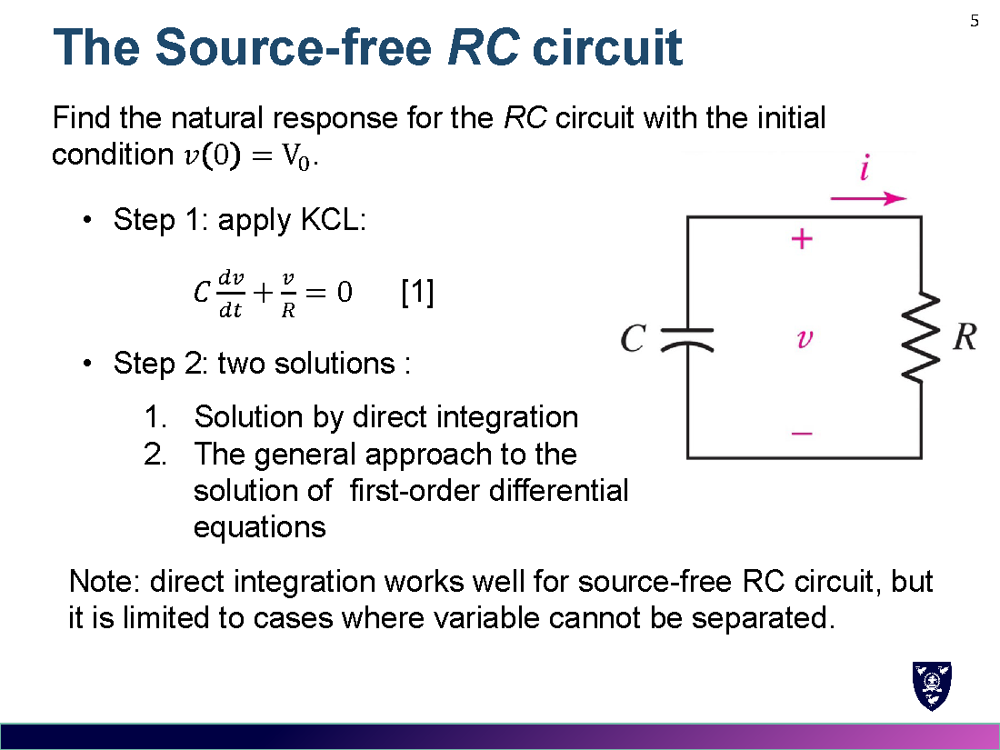
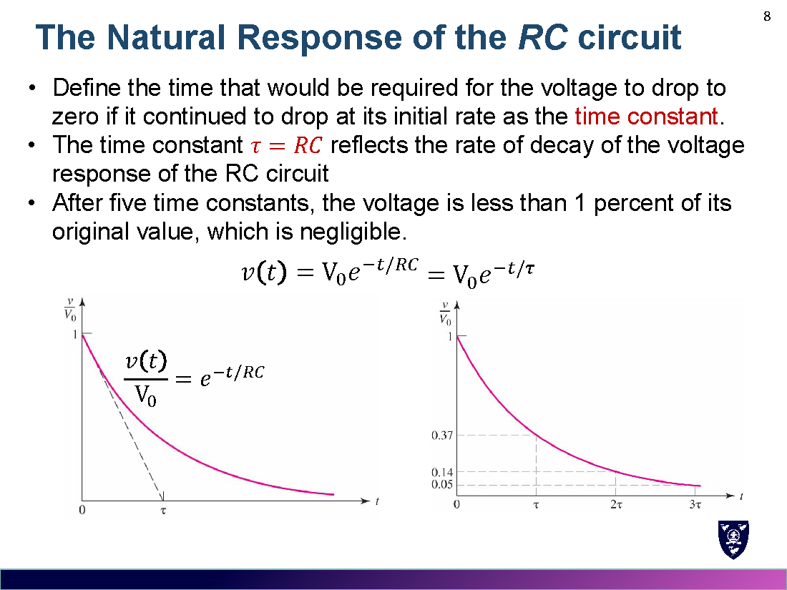
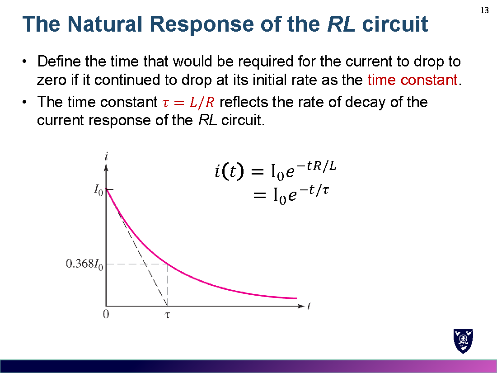
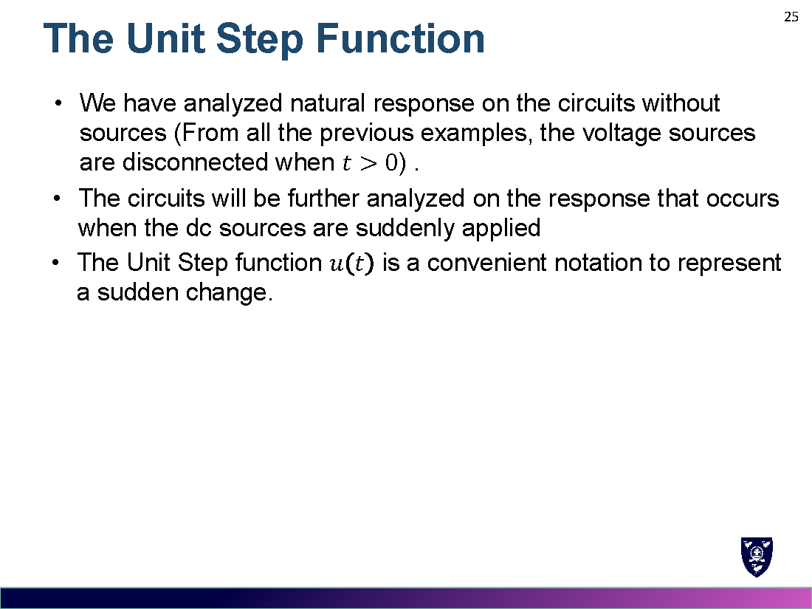
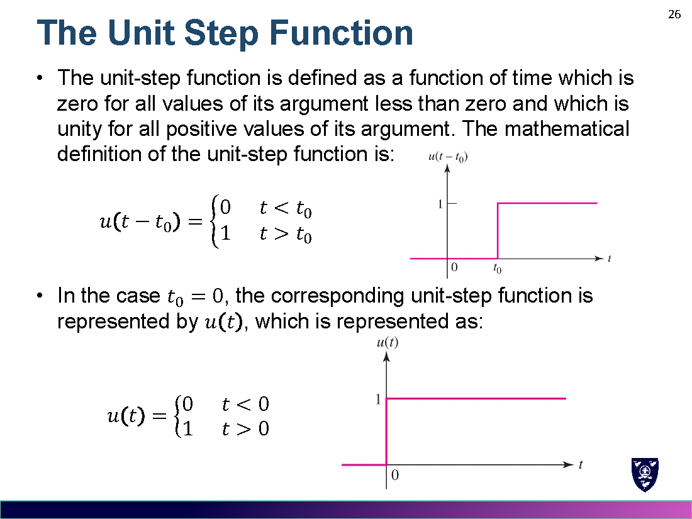
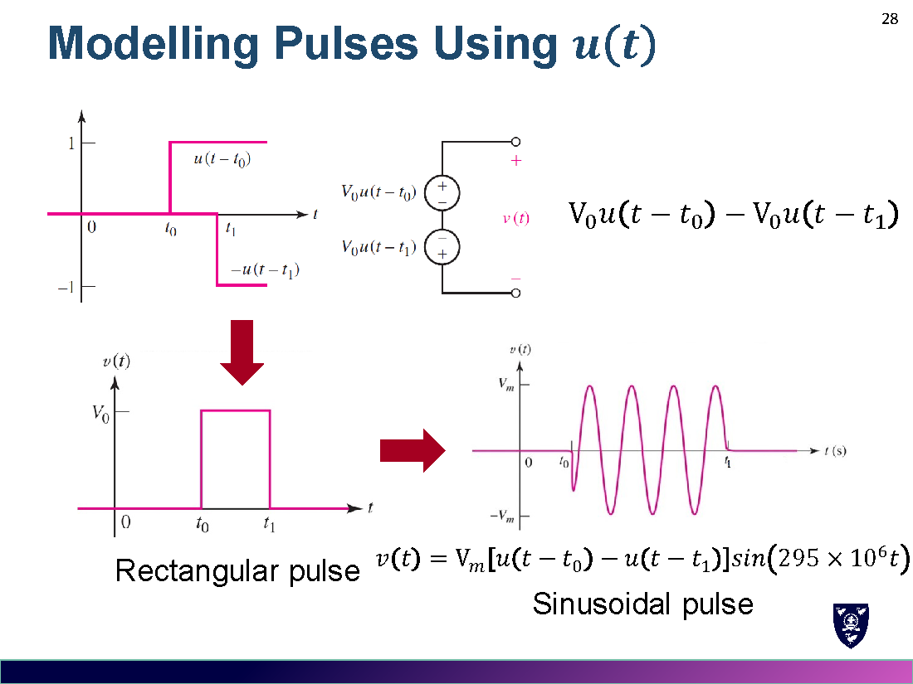
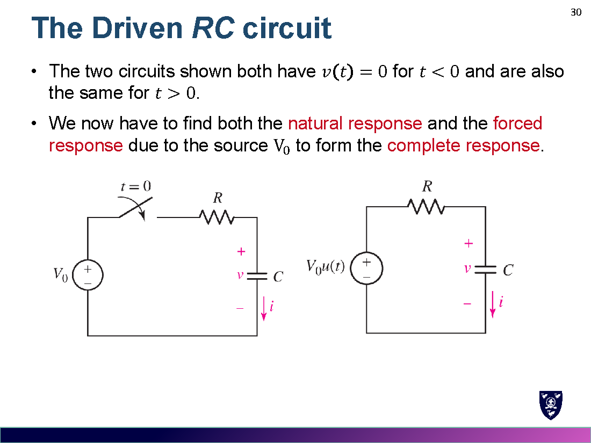
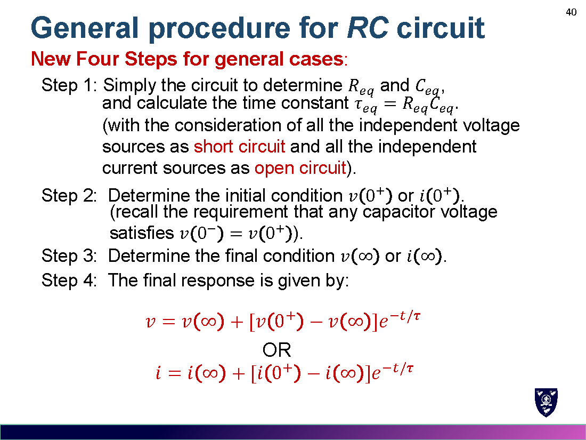
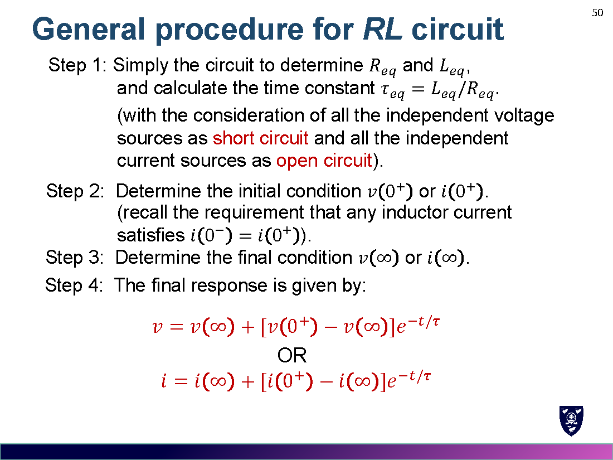

# Week 7 · RC 与 RL 电路
# Basic RC and RL Circuits

> 对应讲义：`Lecture/Week 7 Basic RC and RL circuits.pdf`

---

## 0. 电路响应 / The Circuit Response

含电容/电感的电路用**微分方程**描述。响应有两种描述方式：

1. **稳态 + 暂态**：$v_{complete}=v_{steady\text{-}state}+v_{transient}$
2. **自然响应 + 强迫响应**（本讲重点）：
$$v_{complete}=v_{natural}+v_{forced}$$

- **自然响应 natural**：无外加源时的行为（由储能元件初始状态决定）。
- **强迫响应 forced**：外加源产生的响应。

---

## 1. 无源 RC 电路 / The Source-Free RC Circuit

列 KCL：
$$C\frac{dv}{dt}+\frac{v}{R}=0$$

求解（分离变量或设 $v=Ae^{st}$），结合初值 $v(0)=V_0$：

$$v(t)=V_0\,e^{-t/RC},\qquad \tau=RC$$

### 1.1 时间常数 Time Constant（时间常数）

- $\tau=RC$：电压以**初始速率**衰减到零所需的时间；反映衰减快慢。
- **5τ 后**，电压降到初值的 **1% 以下**，可忽略。

> 例 Example：$v(t)=9e^{-t/60\mu s}$，求 $t=200\,\mu s$ 时 $v=9e^{-200/60}=321.1\,\mathrm{mV}$（<4%）。

---

## 2. 无源 RL 电路 / The Source-Free RL Circuit

列 KVL：
$$L\frac{di}{dt}+Ri=0$$

结合初值 $i(0)=I_0$：

$$i(t)=I_0\,e^{-Rt/L},\qquad \tau=\frac{L}{R}$$

---

## 3. 一般 RC/RL 电路 / General RC/RL Circuits

只有一个储能元件时，先把元件两端的**电阻网络等效为一个 $R_{eq}$**：

$$\tau=R_{eq}C \qquad \text{或} \qquad \tau=\frac{L}{R_{eq}}$$

> 求 $R_{eq}$ 的方法：**从电容/电感两端看进去**的等效电阻（独立源关断）。

### 3.1 一阶响应要点 1st-Order Response Observations

1. 电容电压**不能突变**：$v_C(0^-)=v_C(0^+)$；电容电流可突变。
2. 电感电流**不能突变**：$i_L(0^-)=i_L(0^+)$；电感电压可突变。
3. 电阻电压/电流在开关前后**可以不同**。
4. RC/RL 电路中所有电压、电流都遵循同一个自然响应 $e^{-t/\tau}$。

---

## 4. 单位阶跃函数 / The Unit-Step Function

$$u(t-t_0)=\begin{cases}0, & t<t_0\\ 1, & t>t_0\end{cases}\qquad u(t)=\begin{cases}0, & t<0\\ 1, & t>0\end{cases}$$

- 用来表示**突变的开关动作**（dc 源突然接入）。
- **矩形脉冲**：$v(t)=V_0[u(t-t_0)-u(t-t_1)]$。

---

## 5. 有源（Driven）RC 电路 / The Driven RC Circuit

开关在 $t=0$ 闭合，接入 dc 源 $V_0$。

列 KCL：$C\dfrac{dv}{dt}+\dfrac{v-V_0}{R}=0$，即 $RC\dfrac{dv}{dt}+v=V_0$。

**完整响应 = 自然 + 强迫**：

$$v(t)=V_0-V_0e^{-t/RC}\quad(t>0)$$

### 5.1 求解四步法 General Way（通用四步）

1. **自然响应**：令右端=0，设 $v_n=Ae^{-t/\tau}$。
2. **强迫响应**：由稳态猜 $v_f=v(\infty)=V_0$。
3. **完整解**：$v=v_n+v_f=Ae^{-t/\tau}+v(\infty)$。
4. **定常数**：用初值 $v(0^+)$ 求 $A=v(0^+)-v(\infty)$。

---

## 6. 通用公式 / General Procedure（必背！）

$$\boxed{\,x(t)=x(\infty)+\big[x(0^+)-x(\infty)\big]e^{-t/\tau}\,}$$

其中 $x$ 为待求的电压或电流。四步：

| 步骤 Step | 内容 |
|---|---|
| Step 1 | 简化电路求 $R_{eq},C_{eq}$（或 $L_{eq}$），算 $\tau=R_{eq}C_{eq}$ 或 $\tau=L_{eq}/R_{eq}$（独立源关断） |
| Step 2 | 求**初值** $x(0^+)$（利用 $v_C(0^-)=v_C(0^+)$、$i_L(0^-)=i_L(0^+)$） |
| Step 3 | 求**终值** $x(\infty)$（电容开路、电感短路） |
| Step 4 | 代入 $x(t)=x(\infty)+[x(0^+)-x(\infty)]e^{-t/\tau}$ |

### 6.1 有源 RL 电路 Driven RL

同理：
$$i(t)=\frac{V_0}{R}\left(1-e^{-Rt/L}\right)=\frac{V_0}{R}-\frac{V_0}{R}e^{-Rt/L}\quad(t>0)$$

---

## 7. 例题模板 / Worked Template

**例（RC）**：$v_c(0^-)=\dfrac{50}{50+10}\times120=100\,\mathrm{V}$；$R_{eq}=60\parallel200\parallel50=24\,\Omega$，$\tau=24\times0.05=1.2\,\mathrm{s}$；$v_c(\infty)=\dfrac{50\parallel200}{50\parallel200+60}\times50=20\,\mathrm{V}$。

$$v_c(t)=20+(100-20)e^{-t/1.2}=20+80e^{-t/1.2}\,\mathrm{V}\ (t\ge0)$$

**例（RL）**：$i(0^-)=\dfrac{50}{2}=25\,\mathrm{A}$；$R_{eq}=2\parallel6=1.5\,\Omega$，$\tau=3/1.5=2\,\mathrm{s}$；$i(\infty)=\dfrac{50+50}{2}=50\,\mathrm{A}$。

$$i(t)=50+(25-50)e^{-t/2}=50-25e^{-t/2}\,\mathrm{A}\ (t\ge0)$$

---

## 8. 易错点 / Common Mistakes

1. 求 $\tau$ 时 $R_{eq}$ 是**从储能元件看进去**的等效电阻（独立源要关断）。
2. 初值要用**换路定则**：$v_C$、$i_L$ 在 $0^-$ 与 $0^+$ 相同；$v_R,i_R$ 可以不同。
3. 终值（$t=\infty$）：电容开路、电感短路。
4. 完整响应公式里的系数是 $[x(0^+)-x(\infty)]$，别漏负号/写反。
5. 5τ 规则：$t=5\tau$ 时衰减到初值的 $<1\%$。
6. 用 $u(t)$ 表示分段结果时注意时间区间。

---

## 9. 公式速查 / Formula Summary

$$\text{RC 无源: } v(t)=V_0e^{-t/RC},\ \tau=RC \qquad \text{RL 无源: } i(t)=I_0e^{-Rt/L},\ \tau=\frac{L}{R}$$
$$\text{通用: } \tau=R_{eq}C\ \text{或}\ \frac{L}{R_{eq}},\qquad x(t)=x(\infty)+\big[x(0^+)-x(\infty)\big]e^{-t/\tau}$$
$$\text{换路: } v_C(0^-)=v_C(0^+),\quad i_L(0^-)=i_L(0^+)$$
$$\text{阶跃: } u(t)=\begin{cases}0,&t<0\\1,&t>0\end{cases},\qquad \text{脉冲: } V_0[u(t-t_0)-u(t-t_1)]$$
