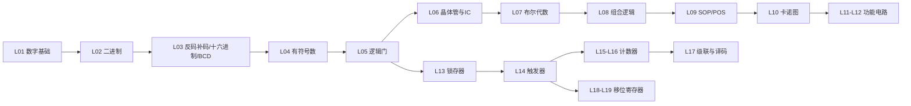

# EEE104 期末复习总览 · Final Exam Review Index

> **EEE104 Digital Electronics (I) — 数字电子技术（一）**
> 教材 Textbook：Floyd, *Digital Fundamentals*（主）；Tocci, *Digital Systems: Principles and Applications*
> 笔记结构：**按 Lecture 逐讲单独成篇**，全部位于 `EEE104/Note/` 下；图片存放于 `EEE104/Note/assets/`。
> Each lecture has its own bilingual note. All notes live in `EEE104/Note/`; figures in `EEE104/Note/assets/`.

---

## 📚 逐讲索引 Lecture Index

| 讲次 | 笔记 Note | 主题 Topic | 课件 File |
|---|---|---|---|
| L01 | [[Lecture 01 模拟量与数字量]] | 模拟/数字量、逻辑电平、波形参数 Analog vs Digital, Logic Levels, Waveforms | 课件不在库中 |
| L02 | [[Lecture 02 二进制数与转换运算]] | 二进制、进制转换、二进制四则运算 Binary Numbers & Arithmetic | Lecture02.pdf |
| L03 | [[Lecture 03 反码补码·十六进制与BCD]] | 反码/补码、十六进制、BCD 码 Complements, Hex, BCD | Lecture03.pdf |
| L04 | [[Lecture 04 有符号数与运算]] | 有符号数表示、加减乘除与溢出 Signed Numbers & Operations | Lecture04.pdf |
| L05 | [[Lecture 05 逻辑门]] | 反相/与/或/与非/或非/异或门 Logic Gates | Lecture05.pdf |
| L06 | [[Lecture 06 晶体管与数字集成电路]] | BJT 开关、IC 封装/分类/系列/参数 Transistors & Digital ICs | Lecture06.pdf |
| L07 | [[Lecture 07 布尔代数]] | 布尔运算、12 条规则、德摩根定理 Boolean Algebra & DeMorgan | EEE104_Lecture_07.pdf |
| L08 | [[Lecture 08 组合逻辑与通用门]] | 组合逻辑、表达式转电路、NAND/NOR 通用门 Combinational Logic | EEE104_Lecture_08.pdf |
| L09 | [[Lecture 09 SOP与POS标准形式]] | 标准 SOP/POS、二进制表示、与真值表互转 Standard Forms | EEE104_Lecture_09.pdf |
| L10 | [[Lecture 10 卡诺图化简]] | 卡诺图、圈 1/圈 0、无关项 Karnaugh Map Minimization | EEE104_Lecture_10.pdf |
| L11 | [[Lecture 11 加法器与比较器（教材补充）]] | 半/全加器、串行进位、比较器 Adders & Comparators ⚠️ 课件缺失，按教材补充 | — |
| L12 | [[Lecture 12 译码编码与数据选择（教材补充）]] | 译码器/编码器、MUX/DEMUX ⚠️ 课件缺失，按教材补充 | — |
| L13 | [[Lecture 13 锁存器]] | S-R 锁存器（高低有效）、门控 S-R/D 锁存器 Latches | EEE104_Lecture_13.pdf |
| L14 | [[Lecture 14 边沿触发器]] | 边沿触发 S-R/D/J-K、异步 PRE/CLR、应用 Edge-Triggered FFs | Lecture 14.pdf |
| L15 | [[Lecture 15 异步计数器]] | 行波计数器、decade、部分译码、74LS93A Asynchronous Counters | Lecture15.pdf |
| L16 | [[Lecture 16 同步计数器]] | 同步二进制/十进制、加减计数、74HC163/160/74LS190 Synchronous Counters | Lecture16.pdf |
| L17 | [[Lecture 17 级联计数器·译码与应用]] | 级联、截断序列、译码毛刺、数字钟 Cascaded Counters & Decoding | Lecture17g.pdf |
| L18 | [[Lecture 18 移位寄存器]] | SISO/SIPO/PISO/PIPO、74HC164/165、应用 Shift Registers | Lecture18_new.pdf |
| L19 | [[Lecture 19 双向移位寄存器与移位计数器]] | 74HC194 双向移位、Johnson/Ring 计数器 Bidirectional SR & SR Counters ⭐ 新增 | Lecture19.pdf |

---

## 🗺️ 知识地图 Knowledge Map

**主线 Main line**：二进制数制 → 逻辑门 → 布尔代数与化简 → **组合逻辑 Combinational Logic**（无存储）；触发器 → **时序逻辑 Sequential Logic**（有存储：锁存器/触发器/计数器/移位寄存器）。

> 期末考试重点 Final exam focus：卡诺图化简、时序电路分析与设计（计数器 J=K 方程）、移位寄存器、综合波形分析。公式与器件参数（延迟、范围、模数）要背。

---

## ✏️ 使用说明 How to Use

1. 每篇笔记末尾有 **自测 Checklist**（Self-test checklist），逐项打勾复习。
2. 图片均取自对应课件（标注了页码来源），可对照课件阅读：`![[EEE104/Note/assets/L19-p05.png]]` 等。
3. 需要快速过一遍时，先看每篇的「本节要点」与文末总表。
4. 相邻讲次互相链接，也可从本页索引跳转。

## 🔗 关联笔记 Related

- [[CSI101/Note/期末复习/00 期末复习总览]]（ICT 课程与本课数字电路部分重叠）
- [[EEE103/Note/00 期中考复习总览]]（电路基础，本课的前置课程）
